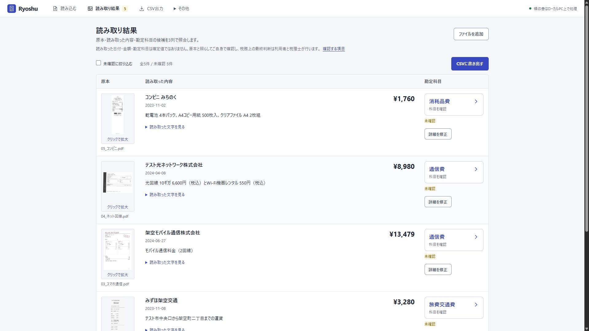
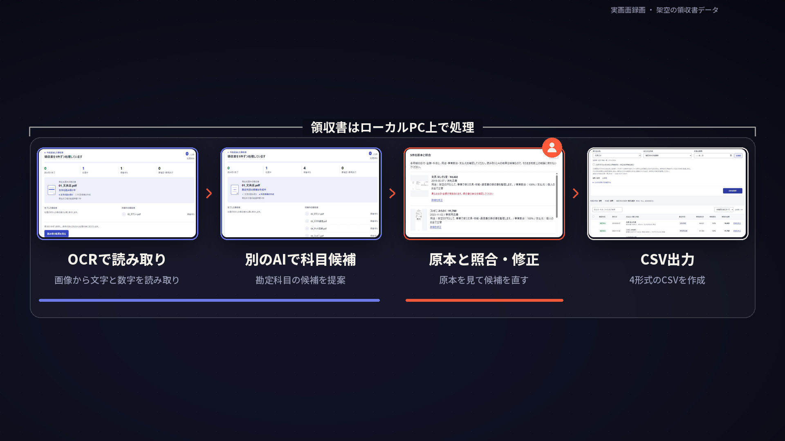

# Ryoshu

**領収書を帳簿に整え、会計ソフトへ渡すCSVを作るWindowsアプリです。読み取りと科目候補の作成はローカルPC上で行い、領収書の画像や内容を外部AIへ送りません。**

個人事業主・フリーランスが、支出の記録と確認を一度に進めるための道具です。Indra OCR 1.1.2が日付や金額を読み取り、llama.cpp上のQwen3 4B（Q4_K_M）が勘定科目の候補を作ります。帳簿には下書きとして残り、原本と見比べてから修正・確認できます。外部AIのアカウントとAPIキーは不要です。

**v1.4.0候補（未公開）** · 現在の公開版は**v1.3.4**です：[Windowsインストーラー](https://github.com/studio-yebisu/ryoshu/releases/download/v1.3.4/Ryoshu-1.3.4-windows-x64-setup.exe) · [v1.3.4の配布一覧](https://github.com/studio-yebisu/ryoshu/releases/tag/v1.3.4) · [公開済みの配布一覧](https://github.com/studio-yebisu/ryoshu/releases) · [変更履歴](CHANGELOG.md) · [v1.3.4の検証範囲](docs/testing/v1.3.4/README.md)

v1.4.0候補の配布物・新しい検証記録・紹介動画は未公開です。以下の画面・動画・数値は公開済み版の記録であり、llama.cppへ移行した候補版の検証結果ではありません。

## 102秒で見るRyoshu

102秒の紹介動画では、OCRによる文字と数字の読み取り、別のローカルAIによる科目候補の作成、原本との照合・修正、CSV出力までの流れを概観できます。実際の操作を録画した架空領収書5件のデモで、科目変更・星付け・CSV保存も収録しています。この動画は公開済み版の記録で、v1.4.0候補の実画面ではありません。

[102秒の紹介動画を再生](https://studio-yebisu.github.io/yaoyorozu-ai-toolbox/media/ryoshu-copy-renewal-20261026/ryoshu-promo-102s.mp4)

## 導入から最初の確認まで

次の手順はv1.4.0候補向けです。候補版の配布はまだありません。現在公開中のv1.3.4を使う場合は、その版の案内を参照してください。

1. 配布が確定したv1.4.0のWindowsインストーラーを実行します。管理者権限は不要です。入手先は[公開済みの配布一覧](https://github.com/studio-yebisu/ryoshu/releases)で確認します。
2. スタートメニューの「Ryoshu」を開き、モデルとMicrosoftの利用条件を確認して初回準備を進めます。OllamaやLM Studioは不要です。Python 3.12.15、固定版の依存、OCRモデル、llama.cpp実行環境、Microsoft Visual C++ v14の公式パッケージと利用条件、約2.5GBのQwenモデルを取得するため、ネット接続と数GB以上の空き容量が必要です。Microsoftパッケージは実行せず、明示された同意がある場合だけDLLをRyoshu専用の保存先へ配置します。Visual StudioやWindows全体へのVC++導入は不要です。インストーラーにこれらの実行環境・Microsoft DLL・モデルは含まれません。
3. ブラウザーで12〜256文字の復元用パスワードを設定します。普段はWindowsが帳簿を開くため、起動のたびに入力する必要はありません。

アプリのコードはMITですが、モデルと依存にはそれぞれの条件があります。特にIndra OCRの重みには事業規模・資金調達額・競合用途などの制限があるため、準備前に[利用条件](THIRD_PARTY.md)を確認してください。ソースZIPから始める場合は`Ryoshu.cmd`を開きます。[導入・更新・終了の手順](docs/INSTALL.md)

## 日々の使い方

1. **取り込む**：PDF・JPG・PNG・WebPを選ぶかドロップし、「読み取りを開始」を押します。1回2000ファイル、1ファイル20MB、画像は2500万画素までです。PDFは「1ファイル＝1取引」（10ページまで）と「1ページ＝1領収書」（300ページまで）から選べます。
2. **進み具合を見る**：処理中のファイル、文字の読み取りと科目候補の工程、完了・待機件数を表示します。「取り込みを一時停止」は未送信の原本の転送だけを止め、保存済みの領収書は読み取りと科目候補の作成を続けます。「取り込みを再開」で残りの原本を送信でき、失敗分の再試行もできます。
3. **原本と見比べる**：「読み取り結果を見る」で、原本・読み取った内容・勘定科目を3列で確認します。原本はクリックで拡大できます。
4. **直して確認する**：科目名からカテゴリーと科目を選び、金額・日付・用途などは「詳細を修正」で直します。13カテゴリー・69科目から選べるほか、独自科目と☆のよく使う科目を使えます。☆と独自科目は帳簿の暗号化DBに保存され、暗号化バックアップにも含まれます。☆の付け外しだけで明細やAI候補は変わりません。
5. **CSVに書き出す**：汎用CSV、freee振替伝票、MFクラウド仕訳帳、弥生デスクトップ25項目形式に対応します。未確認を含む一覧は汎用CSVで保存できます。書き出す前に件数・行数・プレビューを確認してください。

**読み取り結果と科目は候補です。日付・支払先・金額・科目・用途・事業割合・支払元を原本と照らして、ご自身で確認してください。「確認済み」は利用者の操作状態で、税理士の承認ではありません。税務上の最終判断は利用者と税理士が行います。**[確認方針](docs/REVIEW-POLICY.md)

各会計ソフトの実アカウントへの取り込みは未実施です。[使い方](docs/GUIDE.md) · [CSVの形式と制約](docs/CSV-EXPORT.md) · [科目と分類](docs/ACCOUNTS.md)

## 保存と保護

既定の保存先は`%USERPROFILE%\StudioYebisu\ReceiptLedger`です。帳簿DBはSQLCipher、保存済みの原本・プレビュー・暗号化バックアップはAES-256-GCMで保護し、鍵はWindowsの利用者ごとに守ります。

書き出したCSVと原本ファイルは、暗号化されない通常のファイルです。保存先と共有先を管理してください。同じWindowsアカウントで動く不正ソフト、開いた画面の操作、OSの一時領域、移行前にディスクへ書かれた領域は保護の対象外です。

PCの移行・Windowsアカウントの変更・バックアップ復元には復元用パスワードが必要です。Windowsの鍵と復元用パスワードの両方を失うと帳簿を復元できません。パスワードを安全な場所へ保管し、暗号化バックアップを定期的に保存してください。[通信と平文になるもの](docs/PRIVACY.md) · [暗号化と復元の仕様](docs/SECURITY-DESIGN.md)

## 動作要件

v1.4.0候補の対象はWindows 11 x64だけです。Windows 10は未検証で、動作対象として案内していません。JavaScriptが使えるブラウザーが必要です。Windows on ARM（arm64）は対象外です。AIはCPUだけで動作し、OllamaやLM Studioは不要です。最低RAMは未測定で、候補版の検証に使うPCの搭載メモリは128GBです。これは最低要件ではありません。スマホとLAN共有は対象外です。[要件と確認環境](docs/REQUIREMENTS.md)

## 検証記録を読む

次の数値は**2026-10-23に実施したv1.3.0の記録**です。v1.3.4で100件を新規推論した結果ではなく、llama.cppと新しいQwenモデルを使うv1.4.0候補の結果でもありません。固定した100種類の架空PDFを同じ条件で処理した回帰検証であり、未知の実物領収書での正答率を示しません。v1.3.4の検証記録では、v1.3.0以降も科目マスター・OCR・科目候補の生成方法・仕訳計算・CSV形式を変更していないことを確認しています。

| 項目 | 一致 / 評価対象 |
| --- | ---: |
| 金額・円額未確定 | **97/97** |
| 日付 | **99/100** |
| 暫定科目 | **44/48** |
| 科目または保留条件 | 86/100 |

金額の内訳は非負の円額95件と外貨で円額未確定の2件で、返金3件は対象外です。暫定科目の48件は元の期待値で科目提案を求めたケースです。税額は評価対象63件のうち、数値を期待した52件中51件が一致、1件は空欄でした。空欄を期待した11件はすべて一致し、誤った数値は0件でした。返金3件と外貨2件は税額の評価からも除いています。

v1.4.0候補ではモデルと実行環境の両方が変わるため、新しい100件の実推論が完了するまで、上記の速度・精度の記録を候補版へ適用しません。

[全指標・差異・原本・実行範囲（v1.3.0）](docs/testing/v1.3/README.md) · [100件の画像一覧](docs/testing/gallery.md) · [読み取り画面の検証（v1.3.2）](docs/testing/v1.3.2/README.md) · [公開版の検証範囲（v1.3.4）](docs/testing/v1.3.4/README.md) · [版ごとの変更履歴](CHANGELOG.md)

CSV4形式についても、架空6明細から7行を生成し、再読込と借方・貸方とも299,095円の一致を確認しました。これは100件の推論精度とは別の検査です。AIが作る摘要には原本にない表現が残ることがあるため、科目だけでなく購入内容も原本と照合してください。過去の記録として[v1.2.0](docs/testing/v1.2/README.md)と[v1.1.0候補の安全性点検（2026-10-22）](docs/testing/security/README.md)も公開しています。

## 対象外とライセンス

売上・口座照合、減価償却、決算・申告書、返金・外貨の仕訳は対象外です。電子帳簿保存法への適合を認証・保証する製品ではありません。

コードと文書は[MIT License](LICENSE)、Indra OCRの重み・Qwen・llama.cpp・Microsoft Visual C++・依存ライブラリは各利用条件に従います。[参照資料](docs/SOURCES.md) · [開発と検証](CONTRIBUTING.md) · [脆弱性の報告](SECURITY.md)
