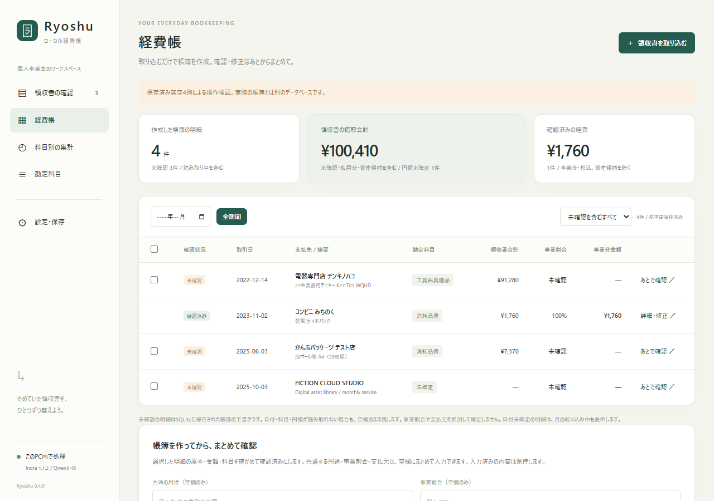

# Ryoshu

**領収書OCRとAIによる勘定科目判断アプリ（各種CSV対応）**

個人事業主・フリーランス向けの、PC内で動く領収書整理・経費帳アプリです。Indra OCR 1.1.2で画像やPDFを読み取り、別のローカルモデルQwen3 4Bが勘定科目の候補を提案します。原本と候補を確認してから帳簿に登録し、汎用CSV・freee・MFクラウド・弥生の形式で出力できます。

現在は **v0.3.0の試作**です。Windows / Python 3.12 / CPUで確認しています。

**[テスト画像と100件の検証結果](docs/testing/README.md)** · **[全100件の画像一覧](docs/testing/gallery.md)** · [動作要件](docs/REQUIREMENTS.md) · [使い方](docs/GUIDE.md) · [CSV仕様](docs/CSV-EXPORT.md)



## できること

- JPG・PNG・WebP・PDFの取り込み、原本・OCR本文・AI候補の比較。1回50ファイル、1ファイル20MB・PDF10ページまで。
- SQLiteの38科目と14種類の確認条件による候補作成。科目の追加、支払先ルールの保存、用途不明の飲食・家事按分・資産候補の確認。
- 事業割合・支払方法を確認した支出の経費帳、科目別集計、税込の仕訳。
- 汎用CSV、freee振替伝票、MFクラウド仕訳帳、弥生デスクトップ25項目形式への出力。税区分や科目名の問題は保存前に表示。
- 原本・帳簿・修正履歴を含むバックアップZIP。

OCR・AIは候補を作ります。業務用途、事業割合、支払元、税区分は本人が確認します。確認操作なしでの自動計上は行いません。売上、口座照合、減価償却、決算・申告書の作成、返金・外貨の仕訳は対象外です。詳細は[帳簿の範囲](docs/GUIDE.md)を参照してください。

## 動作要件

| 項目 | 条件・確認範囲 |
| --- | --- |
| OS | Windows 11・64bitで動作確認。Windows 10、macOS、Linuxでのアプリ全体の確認は未実施 |
| Python | 3.12・64bit。uvがあればセットアップで3.12の環境を準備可能 |
| 起動環境 | Windows PowerShell 5.1以降、日本語フォント、JavaScriptが使えるブラウザー |
| AI実行 | [Ollama](https://ollama.com/download)と`qwen3:4b`。CPUで実行、専用GPUは不要 |
| メモリ | 最低容量は未測定。検証機はRAM 64GB搭載で、これは最低要件ではない |
| 空き容量 | 依存・OCR・LLMで初回に数GB。Qwenモデルは約2.5GB。領収書原本・バックアップの保存領域も必要 |
| 通信 | 初回の依存・モデル取得にネット接続。準備後のOCR・科目判断はPC内で実行 |

CPU・モデル版などの[確認済み環境と詳しい要件](docs/REQUIREMENTS.md)を掲載しています。

## 導入

**モデルの利用条件を先に確認してください。** アプリのコードはMITですが、IndraのOCR重みはmodified OpenRAIL-Mです。事業規模・資金調達額・提供元と競合する用途などに制限があります。重みとLLMは同梱していません。[ライセンスと依存元](THIRD_PARTY.md) / [OCR重みの原文](https://huggingface.co/datalab-to/indra-ocr/blob/bd02167fdf2005a19962cc15188f8496a2c87d3b/LICENSE)

[ソースZIPをダウンロード](https://github.com/studio-yebisu/ryoshu/archive/refs/heads/main.zip)して展開し、先にOllamaを導入します。このソースフォルダーでPowerShellを開き、実行します。

```powershell
powershell -NoProfile -ExecutionPolicy Bypass -File .\setup.ps1
```

準備後は **`Ryoshu.cmd` または `起動.cmd`** をダブルクリックします。[ローカル画面](http://127.0.0.1:8766/)が開きます。詳しい前提、終了方法、復元方法は[導入手順](docs/INSTALL.md)を参照してください。

## テスト画像と結果

[検証ページ](docs/testing/README.md)で、使った架空領収書の画像、元のPDF、期待値、修正前後の結果、残った差異、手動補正を確認できます。[比較CSV](docs/testing/comparison-100.csv)と[結果JSON](docs/testing/results.json)も同梱しています。アプリの「設定・保存」からも開けます。

100件をHTTP取込・Indra OCR・ローカルモデルへ通しました。修正後は金額・円額未確定97/97、日付99/100、暫定科目47/48。返金3件は金額の分母から除外しています。**修正に使った同じ100件の回帰検査であり、未知の実物領収書の正答率ではありません。** 全指標と分母、期待値との判断差は検証ページに記載しています。

CSVは架空の6件を手動確認した別の検査で、4形式の生成・再読込と借貸の一致を確認しました。各会計ソフトの実アカウントへの取り込みは未実施です。

## 保存とプライバシー

保存先は既定で `%USERPROFILE%\StudioYebisu\ReceiptLedger`。SQLiteと原本はソースフォルダーの外に保存します。旧試作との互換性のため、内部のモジュール名と保存先名はReceiptLedgerを使用しています。

読み取り中の画像・本文を外部OCR・LLMへ送信する機能はありません。アプリとOllamaはループバック接続を使い、OCRは準備済みキャッシュから読み込みます。初回の依存関係・モデル取得は外部の配布元へ接続します。保存データとバックアップは暗号化していません。[保存範囲と通信](docs/PRIVACY.md)

## 開発・ライセンス

[開発と検証](CONTRIBUTING.md) / [変更履歴](CHANGELOG.md) / [公開準備の検証範囲](docs/PUBLICATION.md) / [参照資料](docs/SOURCES.md)

このリポジトリのアプリコード・文書は[MIT License](LICENSE)。モデル、依存ライブラリ、フォントはそれぞれの条件に従います。[THIRD_PARTY.md](THIRD_PARTY.md)を確認してください。
