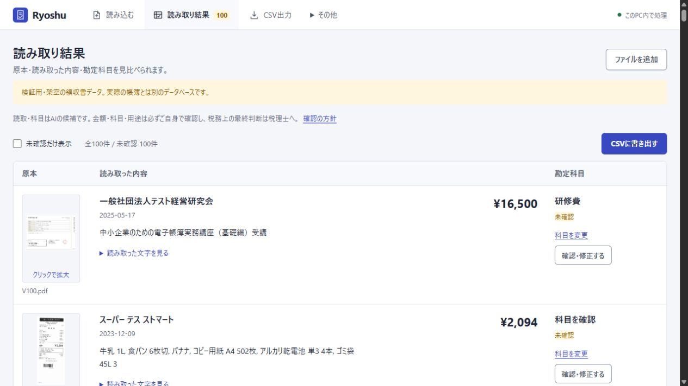

# Ryoshu

**領収書をまとめて取り込み、外部AIに送らず、PC内で帳簿とCSVを作る。**

個人事業主・フリーランス向けのWindowsアプリです。Indra OCR 1.1.2が画像・PDFの日付や金額を読み取り、PC内のQwen3 4Bが勘定科目の候補を作ります。未確認の帳簿を先に作り、あとから原本と見比べて修正・確認できます。

**CSV → freee、MFクラウド、弥生などに取り込み。** 外部AIのアカウント・APIキーは不要です。初回準備では実行環境とモデルをダウンロードします。準備後のOCR・科目候補・CSV出力はローカルで行います。

**v1.3.3** · [Windowsインストーラー](https://github.com/studio-yebisu/ryoshu/releases/download/v1.3.3/Ryoshu-1.3.3-windows-x64-setup.exe) · [配布一覧](https://github.com/studio-yebisu/ryoshu/releases/tag/v1.3.3) · [変更内容](CHANGELOG.md) · [今回の検証範囲](docs/testing/v1.3.3/README.md) · [v1.3.0の100件の検証結果](docs/testing/v1.3/README.md)

v1.3.3では、Windowsで実行環境を準備し直せない問題と、初回の保護設定前に再起動できなくなる問題を修正しました。実インストール先で準備・更新・起動・再起動を確認し、ブラウザーで復元用パスワードの設定画面まで開いています。

読み取り中は、**処理中のファイル・文字読み取り／科目候補の段階・完了／待ち件数**が更新されます。[読み取り中の画面と検証結果](docs/testing/v1.3.2/README.md)も公開しています。

結果一覧の**勘定科目名をクリック**すると、**カテゴリー→勘定科目**の順に選べます。個人事業主の経費・仕入・資産に使う科目を69種類へ増やしました。金額や用途など、科目以外の入力はそのまま残り、確認済みの明細は変更後にもう一度確認します。

**よく使う科目には☆でスターを付けられます。** 次からは「よく使う科目」に並んだボタンで選べます。スターはこの帳簿の暗号化DBに保存され、次回起動と暗号化バックアップにも引き継がれます。スターを付け外ししても明細やAIの候補は変わりません。

## はじめる

1. [Windowsインストーラー](https://github.com/studio-yebisu/ryoshu/releases/download/v1.3.3/Ryoshu-1.3.3-windows-x64-setup.exe)を開き、画面に沿ってインストールします。管理者権限は不要です。
2. ショートカットからRyoshuを起動します。初回はOllamaの導入と、モデルの利用条件を確認してから、実行環境・モデルの準備を進めます。Pythonの手動導入は不要です。
3. ブラウザーが開いたら**復元用パスワード**を設定します。次回以降はWindowsが自動で帳簿を開くため、毎回の入力は不要です。

インストーラーはアプリ本体を配置する導入用です。モデルは同梱せず、初回の準備にはネット接続が必要です。ソースから使う場合は[配布一覧](https://github.com/studio-yebisu/ryoshu/releases/tag/v1.3.3)のZIPを展開し、`Ryoshu.cmd`を開きます。

PDFや画像をドロップして、**「読み取りを開始」**を押します。「読み取り結果を見る」から、**原本画像・読み取った文字と数字・勘定科目**を横に並べて確認できます。画像をクリックすると拡大できます。科目名のボタンからカテゴリー→勘定科目の順に選べます。金額・日付・用途などは「詳細を修正」で直し、内容を確認したら「CSVに書き出す」へ進みます。[詳しい導入手順・更新方法](docs/INSTALL.md)

**モデルの利用条件を確認してから準備を進めてください。** アプリのコードはMITですが、IndraのOCR重みには事業規模・資金調達額・競合用途などの制限があります。[モデルと依存元の条件](THIRD_PARTY.md)

## できること

- 読み取り中は、いま処理しているファイル・文字読み取り／科目候補の段階・完了件数・待ち件数を表示。失敗は別に表示し、再試行できます。
- 複数ファイル・フォルダーを選択。1回2000ファイルまでを順番に保存し、進捗・失敗理由・重複を表示。一時停止・再開・失敗分の再試行に対応。
- PDFを「1ファイル＝1取引」（10ページまで）、または「1ページ＝1領収書」（300ページまで）で取り込み。分割前の元PDFも保存。
- 13カテゴリーから、経費・仕入・資産の69科目を選択。結果一覧から科目だけ変更でき、独自科目も追加できます。支払先ルール、家事按分、資産候補、検索・絞り込み・一括確認に対応。
- よく使う科目を☆で登録。科目変更・確認修正の両画面からすぐ選べ、独自科目にもスターを付けられます。
- 汎用CSV、freee振替伝票、MFクラウド仕訳帳、弥生デスクトップ25項目形式。未確認の内容は汎用の確認用CSVに出せます。
- **帳簿DB・保存済みの原本・プレビューを暗号化。** パスワード付きバックアップ、新しい保存先への復元、パスワードの再設定に対応。

**AIの読取・科目は候補です。原本・金額・科目・用途は必ずご自身で確認し、税務上の最終判断は税理士に確認してください。** 「確認済み」は利用者の操作状態で、税理士の承認を示しません。[確認方針](docs/REVIEW-POLICY.md)

## 動作要件

Windows 11・64bit、JavaScriptが使えるブラウザー、Ollamaを使用します。専用GPUは不要です。初回に数GB以上の空き容量とネット接続が必要で、Qwenモデルは約2.5GBです。Python 3.12.15と固定版の依存を専用フォルダーへ準備します。最低RAMは未測定で、検証機は64GBです。

Windows向けのローカルWebアプリです。インストーラーで導入し、操作画面はブラウザーで開きます。スマホ・LAN共有は対象外です。[詳しい要件と確認環境](docs/REQUIREMENTS.md)

## 100件の検証結果（v1.3.0）

以下は**v1.3.0で実行した記録**です。その後の画面・Windows導入・起動の修正で、科目マスター・OCR・科目判定・CSV生成処理は変えていません。v1.3.3で100件を新規推論した結果ではありません。[今回の検証対象](docs/testing/v1.3.3/README.md)

2026-10-23に、新しい科目マスターを含む候補を固定し、100種類の架空PDFを取り込みました。Indra OCRとPC内のQwenで**全100件を新規処理**し、保存済みのOCR・AI出力は再利用していません。

| 項目 | 一致 / 評価対象 |
| --- | ---: |
| 金額・円額未確定 | **97/97** |
| 日付 | **99/100** |
| 暫定科目 | **44/48** |
| 科目または保留条件 | 86/100 |

金額の97件は、非負の円額95件と、外貨で円額未確定の2件です。**返金3件は金額の評価から除外**しています。暫定科目の48件は、元の期待値で科目提案を求めるケースです。

事前に指定した税額の確認範囲は63件です。数値を期待する52件中51件が一致、1件は空欄でした。空欄を期待する11件は11件が一致し、誤った数値の出力は0件でした。返金3件と外貨2件は、この税額評価からも事前に除外しています。

**改善に使った同じ100件の回帰検証であり、未知の実物領収書の正答率ではありません。** [全指標・差異・原本・実行範囲](docs/testing/v1.3/README.md)と[100件の画像一覧](docs/testing/gallery.md)を公開しています。CSV4形式の生成・再読込・借貸一致は別に確認しました。各会計ソフトの実アカウントへの取り込みは未実施です。

暫定科目は旧版の47/48から44/48になりました。新たな不一致3件の候補は旧版と同じ「外注工賃」ですが、旧版では別名だった「外注費」を正式科目として分けたため、元の期待値との照合で不一致になりました。残る1件は年間研修の期間配分を確認する保留です。元の期待値は変更していません。金額・日付・税額・提案や保留の一致状態は旧版と同じです。[v1.2.0の結果](docs/testing/v1.2/README.md)と[v1.1.0候補の安全性点検](docs/testing/security/README.md)も残しています。AIの摘要にも原本にない表現が残るため、確認が必要です。

## 保存と保護

保存先は既定で `%USERPROFILE%\StudioYebisu\ReceiptLedger`。内部DBはSQLCipher、原本等はAES-256-GCMで暗号化し、鍵はWindowsの利用者ごとに保護します。旧版からの移行では、原本と全テーブルを照合してから切り替えます。旧版のバックアップZIPも復元できます。

**書き出したCSV・原本は暗号化されない通常のファイルです。** 同じWindowsアカウントの不正ソフト、開いた画面の操作、OSの一時領域、移行前に書かれたディスク領域までは保護できません。復元用パスワードは安全な場所へ保管し、暗号化バックアップを定期的に保存してください。**Windowsの鍵と復元用パスワードの両方が使えなくなると、帳簿を復元できません。** [保護範囲と通信](docs/PRIVACY.md) · [暗号化の仕様・制約](docs/SECURITY-DESIGN.md)

詳しい使い方・開発資料

[使い方](docs/GUIDE.md) · [科目一覧と分類範囲](docs/ACCOUNTS.md) · [CSV仕様](docs/CSV-EXPORT.md) · [変更履歴](CHANGELOG.md) · [開発と検証](CONTRIBUTING.md) · [脆弱性の報告](SECURITY.md) · [参照資料](docs/SOURCES.md)

売上・口座照合、減価償却、決算・申告書、返金・外貨の仕訳は対象外です。電子帳簿保存法への適合を認証・保証する製品ではありません。コードと文書は[MIT License](LICENSE)、モデルと依存ライブラリは各利用条件に従います。

