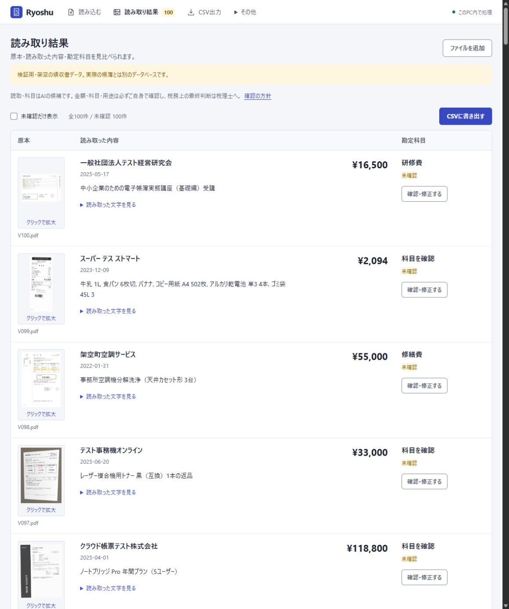

# Ryoshu

**領収書をまとめて取り込み、外部AIに送らず、PC内で帳簿とCSVを作る。**

個人事業主・フリーランス向けのWindowsアプリです。Indra OCR 1.1.2が画像・PDFの日付や金額を読み取り、PC内のQwen3 4Bが勘定科目の候補を作ります。未確認の帳簿を先に作り、あとから原本と見比べて修正・確認できます。

**CSV → freee、MFクラウド、弥生などに取り込み。** 外部AIのアカウント・APIキーは不要です。初回準備では実行環境とモデルをダウンロードします。準備後のOCR・科目候補・CSV出力はローカルで行います。

**v1.2.0** · [ダウンロード](https://github.com/studio-yebisu/ryoshu/releases/tag/v1.2.0) · [変更内容](CHANGELOG.md) · [100件の検証結果](docs/testing/v1.2/README.md)

明細の税額と領収書全体の税額を区別する処理を修正しました。画面は白・藍色を基調に、ファイルを入れる→読み取りを開始→原本と候補を確認→CSVへ進む流れに整理しています。

## はじめる

1. 初回だけ、PC内でAIを動かすための[Ollama Windows版](https://ollama.com/download)を導入します。
2. [配布ZIP](https://github.com/studio-yebisu/ryoshu/releases/tag/v1.2.0)を新しいフォルダーへ展開し、**`Ryoshu.cmd`** をダブルクリックします。コマンド画面でモデルの利用条件を確認して続行すると、必要なPython・ライブラリ・モデルを自動で準備します。
3. ブラウザーが開いたら**復元用パスワード**を設定します。次回以降はWindowsが自動で帳簿を開くため、毎回の入力は不要です。

PDFや画像をドロップして、**「読み取りを開始」**を押します。「読み取り結果を見る」から、**原本画像・読み取った文字と数字・勘定科目**を横に並べて確認できます。画像をクリックすると拡大できます。確認・修正したら「CSVに書き出す」へ進みます。[詳しい導入手順・更新方法](docs/INSTALL.md)

**モデルの利用条件を確認してから準備を進めてください。** アプリのコードはMITですが、IndraのOCR重みには事業規模・資金調達額・競合用途などの制限があります。[モデルと依存元の条件](THIRD_PARTY.md)

## できること

- 複数ファイル・フォルダーを選択。1回2000ファイルまでを順番に保存し、進捗・失敗理由・重複を表示。一時停止・再開・失敗分の再試行に対応。
- PDFを「1ファイル＝1取引」（10ページまで）、または「1ページ＝1領収書」（300ページまで）で取り込み。分割前の元PDFも保存。
- 38科目と15種類の確認条件で候補を整理。科目追加、支払先ルール、家事按分、資産候補、検索・絞り込み・一括確認。
- 汎用CSV、freee振替伝票、MFクラウド仕訳帳、弥生デスクトップ25項目形式。未確認の内容は汎用の確認用CSVに出せます。
- **帳簿DB・保存済みの原本・プレビューを暗号化。** パスワード付きバックアップ、新しい保存先への復元、パスワードの再設定に対応。

**AIの読取・科目は候補です。原本・金額・科目・用途は必ずご自身で確認し、税務上の最終判断は税理士に確認してください。** 「確認済み」は利用者の操作状態で、税理士の承認を示しません。[確認方針](docs/REVIEW-POLICY.md)

## 動作要件

Windows 11・64bit、JavaScriptが使えるブラウザー、Ollamaを使用します。専用GPUは不要です。初回に数GB以上の空き容量とネット接続が必要で、Qwenモデルは約2.5GBです。Python 3.12.15と固定版の依存を専用フォルダーへ準備します。最低RAMは未測定で、検証機は64GBです。

Windows向けのローカルWebアプリです。ブラウザーで操作し、単体のexeではありません。スマホ・LAN共有は対象外です。[詳しい要件と確認環境](docs/REQUIREMENTS.md)

## 100件の検証結果（v1.2.0）

2026-10-22に、固定した候補で100種類の架空PDFを取り込み、Indra OCRとPC内のQwenで**全100件を新規処理**しました。保存済みのOCR結果は再利用していません。

| 項目 | 一致 / 評価対象 |
| --- | ---: |
| 金額・円額未確定 | **97/97** |
| 日付 | **99/100** |
| 暫定科目 | **47/48** |
| 科目または保留条件 | 89/100 |

金額の97件は、非負の円額95件と、外貨で円額未確定の2件です。**返金3件は金額の評価から除外**しています。暫定科目の48件は、元の期待値で科目提案を求めるケースです。

今回追加した税額の確認範囲は63件です。数値を期待する52件中51件が一致、1件は空欄でした。空欄を期待する11件は11件が一致し、誤った数値の出力は0件でした。返金3件と外貨2件は、この税額評価からも事前に除外しています。

**改善に使った同じ100件の回帰検証であり、未知の実物領収書の正答率ではありません。** [全指標・差異・原本・実行範囲](docs/testing/v1.2/README.md)と[100件の画像一覧](docs/testing/gallery.md)を公開しています。[v1.1.0候補の結果・安全性点検](docs/testing/security/README.md)は履歴として残しています。CSV4形式の生成・再読込・借貸一致は別に確認しました。各会計ソフトの実アカウントへの取り込みは未実施です。

科目等の集計はv1.1.0候補と同じです。税額の修正と、事業概要が空欄の追加5件は別に検証しました。AIの摘要には原本にない表現が残るため、摘要も確認が必要です。

## 保存と保護

保存先は既定で `%USERPROFILE%\StudioYebisu\ReceiptLedger`。内部DBはSQLCipher、原本等はAES-256-GCMで暗号化し、鍵はWindowsの利用者ごとに保護します。旧版からの移行では、原本と全テーブルを照合してから切り替えます。旧版のバックアップZIPも復元できます。

**書き出したCSV・原本は暗号化されない通常のファイルです。** 同じWindowsアカウントの不正ソフト、開いた画面の操作、OSの一時領域、移行前に書かれたディスク領域までは保護できません。復元用パスワードは安全な場所へ保管し、暗号化バックアップを定期的に保存してください。**Windowsの鍵と復元用パスワードの両方が使えなくなると、帳簿を復元できません。** [保護範囲と通信](docs/PRIVACY.md) · [暗号化の仕様・制約](docs/SECURITY-DESIGN.md)

詳しい使い方・開発資料

[使い方](docs/GUIDE.md) · [38科目と分類範囲](docs/ACCOUNTS.md) · [CSV仕様](docs/CSV-EXPORT.md) · [変更履歴](CHANGELOG.md) · [開発と検証](CONTRIBUTING.md) · [脆弱性の報告](SECURITY.md) · [参照資料](docs/SOURCES.md)

売上・口座照合、減価償却、決算・申告書、返金・外貨の仕訳は対象外です。電子帳簿保存法への適合を認証・保証する製品ではありません。コードと文書は[MIT License](LICENSE)、モデルと依存ライブラリは各利用条件に従います。

