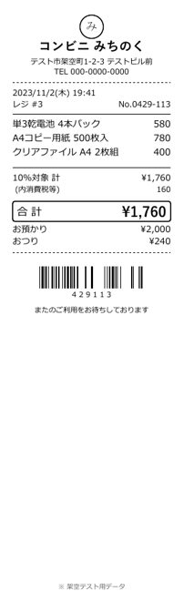
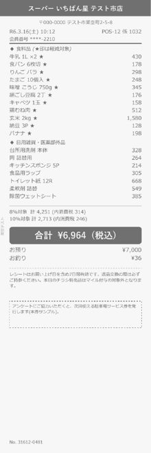
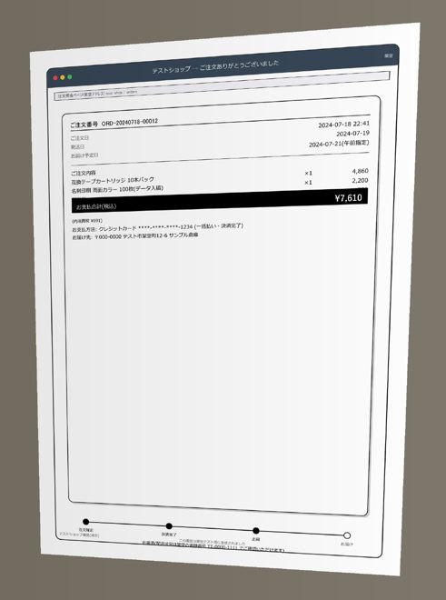

# テスト画像と100件の検証結果

[READMEへ戻る](../../README.md) / **[全100件の画像一覧](gallery.md)** / [画像と結果を一緒に見るHTML](index.html) / [比較CSV](comparison-100.csv) / [結果JSON](results.json)

2026-10-21に、架空の100件を実際の取込APIから登録し、Indra OCRとローカルQwenモデルへ通しました。修正に使った同じデータの回帰検査です。未知の実物領収書の精度を示すものではありません。元のPDF・期待値を変更せず、残った差異と手動補正も含めて記録しています。

## 使った画像・PDF

| 電子レシート | 薄い印字 | 斜め撮影 |
| --- | --- | --- |
|  |  |  |

**[全100件の画像一覧](gallery.md)**から各原本PDFを開けます。[個別PDF100件ZIP](../../samples/receipts-100-v2/receipts-100.zip)は取り込み用、[100ページ合本](../../samples/receipts-100-v2/receipts-100-review.pdf)は閲覧用です。アプリにはZIP内の個別PDFを50件ずつ取り込みます。1ファイルを1支出として扱うため、合本は取り込まないでください。

100種類のレイアウトを6モデルが分担して設計しました。電子48、平面スキャン18、薄い印字12、FAX8、斜め撮影10、回転4件です。手書き風の帳票もフォントで描画したもので、本物の手書き文字ではありません。[作成条件と保存済み描画コード](../../samples/receipts-100-v2/README.md)

## 方法

モデルへ渡したのはPDFから得たOCR本文・座標等と、全件共通の「個人事業主、ソフトウェア・ゲーム制作、デザイン業」という事業概要です。各件の期待値・`human_context`は採点側だけで読み、モデルには渡していません。金額・日付・支払先の根拠確認、科目辞書、確認条件を含むアプリ全体の結果を採点しています。

元の期待値は[manifest.json](../../samples/receipts-100-v2/manifest.json)に保持しています。SHA-256は`1b9e40688cc730724328923c7f3b5ce1cd7941fb102fdf369dd58968d3b151c7`です。各PDFのハッシュもmanifestと結果JSONにあります。

検証環境はWindows、Python 3.12.9、Indra OCR 1.1.2、CPU、Ollama `qwen3:4b`（Q4_K_M、GPU不使用）。OCR revisionは`bd02167fdf2005a19962cc15188f8496a2c87d3b`、Qwen digestは`359d7dd4bcdab3d86b87d73ac27966f4dbb9f5efdfcc75d34a8764a09474fae7`です。

100件通しの修正後実行の後、見出し再読取の影響10件と発行者名候補の影響13件をPDFのアップロードから再検査しました。重複2件を含みます。変更されない入力・判定条件を全100件で比較し、影響のないケースの実行記録を保持しました。最後の支店断片の補助修正は単体回帰検査と全100件の入力・条件比較で変更0件でした。全件の実行元・採点値・元ソースハッシュは結果JSONにあります。

公開準備では名称とサンプル配置を変更しています。下表はその前に記録した実OCR・AIの回帰結果です。公開準備で同じ100件のモデル推論を再実行したとするものではありません。公開候補では単体・API検査を再実行し、OCR・モデル・会計処理のソースが変わっていないことを照合します。[公開準備の検証範囲](../PUBLICATION.md)

## 結果

| 項目 | 修正前 | 修正後 |
| --- | ---: | ---: |
| OCR完了 | 100/100 | 100/100 |
| 意味判断モデル完了 | 100/100 | 100/100 |
| 金額・円額未確定の一致 | 62/97 | 97/97 |
| 日付の一致 | 73/100 | 99/100 |
| 支払先の一致 | 52/100 | 86/100 |
| 暫定科目が許容候補と一致 | 35/48 | 47/48 |
| 提案・保留・停止・資産検討の一致 | 55/100 | 93/100 |
| 科目または保留条件の一致 | 50/100 | 89/100 |

「一致」は元の期待値に対する厳密比較です。支払先は空白・Unicode表記を正規化します。法人名や支店名の省略、架空表記の有無も不一致に含まれるため、86/100をそのまま14件の実質誤判定とはみなしません。目視の説明で点数を加えていません。

金額の分母97は、非負の円額95件と外貨で円額未確定の2件。負の返金V019・V080・V097の3件は通常の経費に対応しないため除外し、停止判定を別に評価しています。V097のモデル金額には元購入額33,000円が残り、返金11,000円を正しく扱えたという結果ではありません。返金仕訳は未対応です。

暫定科目は`propose`を期待する48件が分母です。`hold`の元の期待値は科目が空欄であることも要求するため、日付欠落を保留しながら妥当な科目候補を保持しても「科目または保留条件」は不一致になります。最終の内訳は提案50、保留31、資産検討6、停止13。確認用DBは100件とも未登録、仕訳0件でした。

修正前の検証DBには、中間の読取用スクリプトが一度、新しい初期値を適用しました。元へ戻し、影響したV029〜V031を凍結した元ソースで再実行しています。修正前の集計にはこの3件の訂正測定を使い、元の観測と訂正記録は私的な検証保存先に保持しています。通常の帳簿DBは別です。

## 原因と修正

- 合計と税額・釣銭・前回残高・予約金の混同を、ラベル・位置・別記金額・計算関係で照合するようにしました。
- 斜めの紙面、細い見出し、ロゴの読取漏れに、透視補正と必要な部分の再読取を追加しました。原本と各読取結果を保持します。
- 宛名や部屋名を支払先とする誤りに、発行者候補と見出し・支店断片を区別する処理を追加しました。
- 「発送」を送料、「食品保存容器」を食品、宛名のベーカリーを飲食物とする誤一致を修正しました。
- 年額サービス、用途不明のギフト、謝礼・源泉、外貨等は確認事項を優先します。科目コードの取り違えを減らすため、DBの日本語科目名から選ばせています。

元の期待値と安全な保留にも判断差があります。V011は期待値が納品日5/22、原本の発行日が5/20で、未払いとして停止。V073は年額研修を研修費の提案とする期待値に対し、期間配分の確認で保留しました。税の納付・過料・社内精算書には、期待値の保留より強い停止があります。各ケースの説明は[HTML](index.html)または[比較CSV](comparison-100.csv)にあります。

## 目視で修正した3件

| ケース | 元のAI候補 | 確認欄の補正 | 根拠 |
| --- | --- | --- | --- |
| V070 | かんぶパッケージ テスト店 | かんぷパッケージ テスト店 | 原本の半濁点 |
| V088 | テスト市みらい食堂 | 特定非営利活動法人 テスト市みらい食堂 | 別行の法人種別 |
| V099 | スーパー テス ストマート | スーパーテストマート 架空町店 | ロゴと支店名 |

下書きの確認欄だけを修正し、元のモデル候補と上表の自動採点値は保持しています。[手動補正記録](manual-corrections.json) / [原本画像](gallery.md)。V056の期待値には原本に印字されていない法人種別等があるため、AIが読んだ短い名称を架空の文字で補完していません。

## CSVの検証

別の架空の免税個人事業主という条件で、V001・V021・V005・V042・V061・V004を手動確認しました。これはOCR・科目判定の点数とは別です。未確認の外貨1件が仕訳へ入らないことも確認しました。

実APIから4形式を生成してCSVとして再読込し、6件・7仕訳行、借貸とも299,095円、事業分296,877円、私用分2,218円で一致しました。経費205,597円と資産91,280円を分けています。**各会計ソフトの実アカウントへの取り込みは未実施**です。[形式と公式出典](../CSV-EXPORT.md)

[汎用仕訳](csv/qa-exempt-generic-journal.csv) / [freee](csv/qa-exempt-freee-journal.csv) / [MF](csv/qa-exempt-mf-journal.csv) / [弥生](csv/qa-exempt-yayoi-journal.csv) / [検査JSON](csv-verification.json)

出力例は架空の手動確認済みデータです。自分の帳簿へ取り込まないでください。

## 再検証

モデル不要の単体・API検査と、モデルを使う100件の検査は[開発手順](../../CONTRIBUTING.md)に分けて記載しています。真の領収書や利用者のDB、モデル重み、私的な実行ログは同梱していません。公開JSONからは端末パスとローカル記録IDを省き、採点・原本・期待値を追える項目を残しています。
