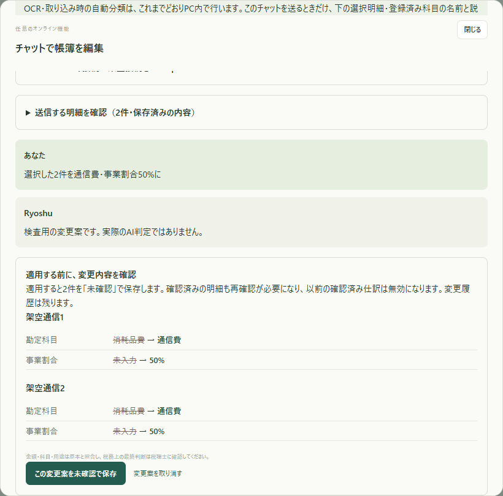
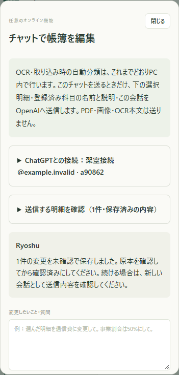

# 任意のOAuth・チャット編集の検証

対象はv1.1.0です。**実アカウントでOpenAI OAuthに接続し、実モデルによるチャット編集まで確認しました。** 公開済みv1.0.0の配布ZIP・100枚OCR検証とは分けて記録します。

- Python：既存130件と、新規42件の計172件。新規分はOAuthの署名・state・nonce・期限・登録ID・更新、接続待ちの時間切れ・中止・再試行、選択明細の範囲、外部送信の明示、更新競合、一括保存、二重適用、未確認への差し戻し、通信例外の範囲、応答形式を検査。
- 画面：既存28項目と新規15項目。実ブラウザー・HTTP・SQLiteを使用。新規分のOAuth応答・モデル出力は架空のものを使い、外部への推論リクエストは送っていません。
- CSV：架空6件・7仕訳行を4形式で生成・再読込。借貸299,095円の一致を確認。会計ソフトの実アカウントへの取り込みは未確認。
- 原本と期待値：従来の100件のPDF・ZIP・期待値・検証結果と、OCR・自動分類の主要処理ファイルを変更していないことを確認。
- 実接続：利用者自身がOpenAIの画面でログインとプラン利用を許可。その接続でモデル一覧を取得し、`gpt-6-luna`との2往復で架空2明細を編集。サーバー再起動後も保存済みの接続で利用できることを確認。

既存ブラウザー検査のOCR・AIは保存済みの架空データを再現しています。42件の新規Python検査と15件の画面検査は架空の認証・応答を使い、実接続の検査とは別です。結果の一覧は[verification.json](verification.json)。[使い方と送信範囲](../../CHAT-EDIT.md)。

## 実アカウント・実モデルで確認したこと

2026-10-22、通常の帳簿と分けた検証用DBに公開済みの架空PDF V044・V045と、選択しない対照V001を登録しました。この検査ではOCRを再実行せず、初期値を意図的に「消耗品費・事業割合100%」にしています。

1. 利用者自身が公式のOpenAI画面でOAuth接続とプラン利用を許可。保存済みの接続を再起動後に読み込み、アカウントのモデル一覧を取得。
2. Chrome上のアプリから、選択した2件の状態について説明だけを依頼。実モデル`gpt-6-luna`は現在値を回答し、編集案を作らず、帳簿も変更しなかった。
3. 同じ会話で「通信費・50%に変更し、金額・日付・ほかの項目は保持」と依頼。2件の変更前後が表示され、保存するまではDBと履歴が変わらなかった。
4. 「この変更案を未確認で保存」を操作。2件の科目・事業割合だけが変わり、版は各1回増加、状態は未確認、変更履歴は各1件。確認済み仕訳は作られなかった。
5. 金額・日付など、ほかの全入力項目と対照V001は変更なし。同じ編集案を再適用しても、版・履歴・帳簿は増えなかった。

明細の適用前後と照合結果は[live-account.json](live-account.json)に掲載しています。アカウント名・メール・認証コード・トークン・端末パスは含めません。OAuth接続時のコードとチャット編集時のコードを固定コミットとハッシュで記録しています。

この実接続は1アカウント・1モデル・架空2明細での機能検査です。実トークンの更新・解除、複数の実アカウント、すべてのモデルの編集精度、会計ソフトへの実取り込みは未確認です。100枚のOCR・ローカル科目候補の回帰結果とは別の検査です。

## 指摘と修正

ユーザー指定のKimi K3とOpus 5.5を、それぞれ既存のCLIから実行してレビューしました。コマンドのモデル指定は`kimi-code/k3`、`claude-opus-5-5`です。レビューはコードの確認であり、実アカウント接続の検証ではありません。

| 指摘 | 対応と確認 |
| --- | --- |
| SSEの終端・未完了・エラーの取りこぼし | 終端なしの最終イベント・DONE・失敗・途中切れを検査。完了を確認できなければ編集案を作らない |
| 初回登録の途中失敗で別の登録が増える | 検証前の登録IDだけを別枠で保持し、再試行で再利用。本人情報・トークンは検証完了後に保存 |
| 別タブや再接続後に、古い接続先の送信確認が残る | 画面が選んだ接続IDをサーバーでも照合。接続先が変われば送信を止め、モデルと送信確認を解除 |
| 適用後に古い会話が続いて見える | 新しい会話になることを表示し、送信確認を解除 |
| 会話リセットで、未送信の日本語入力が消える | 入力を保持する。接続待ちのポーリングでも、変化がなければ入力要素を作り直さない |
| 保存済みなのに返事が来ず、案を取り消せたと誤解する | 結果不明を明示。案の取り消しと新規依頼を止め、同じIDで保存結果を確認。実保存後に応答を捨てる画面テストで検査 |
| 接続済みの人が、再接続のつもりで新規登録する | 接続済みの場合は再接続を主操作にし、別登録は「別のChatGPT接続を追加」と表示 |
| 旧環境でOAuthの依存が不足する | 接続前にセットアップを案内。依存を更新したWindowsの既存実行環境でも検査 |
| ログイン画面を見失う・時間切れ後に古い案内が残る | 開き直すリンクを案内。時間切れ・中止後は接続ボタンから再試行する説明に変更。古いタイマーが新しい接続や成功後の表示を上書きしないことも検査 |

Opusの再確認では6点を解消済み、残るP1/P2なしと回答。Kimiも元の4点を解消・撤回と回答しました。Kimiが使った旧環境の依存不足と、想定外のJSON形状に関する追加指摘も修正・検査しています。第三者の完了報告だけで合格とせず、親エージェントが実行したテスト結果で確認しています。

新しいチャット画面・README・使い方の日本語は、利用者指定のAntigravityターミナル経由で`gemini-3.8-flash-high`にも確認させました。ログイン画面への導線と時間切れ後の案内を改善。時間切れ後は接続待ち自体が終了することを実測し、その状態に合う再試行手順にしています。税理士への最終確認は既存の画面・適用前の案内に維持しています。

## 画面

すべて架空の接続先・明細です。

