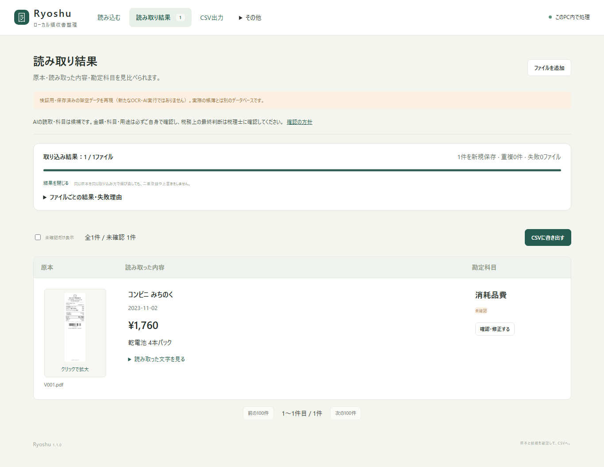

# v1.1.0候補：100件の再検証と安全性の点検

[Ryoshuへ戻る](../../../README.md) / **[画像・読み取り・科目を並べて見る](index.html)** / [全100件の画像一覧](../gallery.md) / [比較CSV](comparison-100.csv) / [結果JSON](results-100.json)

2026-10-22に暗号化対応候補を凍結し、**100種類の架空PDFを、HTTP取込→Indra OCR→ローカルQwenによる科目候補まで新規実行**しました。OCRの結果を再利用した検査ではありません。改善に使った同じ100件の回帰検証であり、未知の実物領収書の正答率ではありません。[原本・期待値](../../../samples/receipts-100-v2/manifest.json)と[v1.0.0の過去結果](../v1/README.md)は変更していません。

**最終統合の状態は[finalization.json](finalization.json)に記録します。** 100件の推論完了と、推論後の安全性修正・UI変更に対する最終試験は別です。最終のローカル検査は成功しました。GitHub Actionsと公開物の確認は、別のリリース工程として追跡します。

## 100件の結果

| 項目 | 一致 / 評価対象 |
| --- | ---: |
| OCR完了 | 100/100 |
| ローカル意味判断モデル完了 | 100/100 |
| 金額・円額未確定の一致 | **97/97** |
| 日付の一致 | **99/100** |
| 支払先の一致 | 86/100 |
| 暫定科目が許容候補と一致 | 47/48 |
| 提案・保留・停止・資産検討の一致 | 93/100 |
| 科目または保留条件の一致 | 89/100 |

金額の分母は非負の円額95件と、外貨で円額未確定の2件です。**返金V019・V080・V097の3件は金額の評価から除外**しています。返金の金額処理・仕訳が正しいという意味ではなく、返金仕訳は未対応です。

暫定科目は、元の期待値が`propose`の48件が対象です。「科目または保留条件」は厳密な元の期待値を使います。たとえば`hold`を期待するケースは科目の空欄も要求するため、保留しながら候補を残した場合も不一致になります。日付はV011が不一致で、元の期待値の納品日と、読み取った発行日が異なります。V073は研修費の提案を期待したのに対し、期間配分の確認で保留しました。これらを説明だけで正解へ加算していません。

金額・日付・支払先・勘定科目はアプリ全体の出力です。全件共通の事業概要を渡しましたが、ケースID・期待値・各件の業務背景はモデルに渡していません。100件とも未確認、仕訳0行の状態で採点しており、自動で税務判断を確定していません。原本・金額・科目・用途を利用者が確認し、税務上の最終判断は税理士に確認してください。

## 実行環境とソースの範囲

- Windows 11、AMD Ryzen 9 7950X3D、RAM 64GB、Python 3.12.15。
- Indra OCR 1.1.2、CPUExecutionProvider。OCR重みのrevisionは`bd02167fdf2005a19962cc15188f8496a2c87d3b`。
- Qwen3 4B / Q4_K_M、CPU・6スレッド。digestは`359d7dd4bcdab3d86b87d73ac27966f4dbb9f5efdfcc75d34a8764a09474fae7`。実行後に確認したOllamaは0.40.7です。
- 実行時間は1,105.7秒、約18分26秒。この1台・同じ架空100件での記録であり、一般の処理速度保証ではありません。

[結果JSON](results-100.json)は期待値、観測値、OCR本文、科目候補、判定理由、個別の一致条件、PDFハッシュを公開用に抽出したものです。利用者パス、内部receipt ID、PID、実行ポート、認証情報は含めません。元ログのハッシュと[凍結時のソースハッシュ](source-hashes.json)を保持しています。

元の`report.json`には途中の`status: processing`が残りました。一方、`run.json`は`complete`と終了日時を記録し、個別100件・OCR100件・モデル100件の完了記録があります。公開JSONはその違いを記載し、生ログを完了表示に書き換えていません。

100件の凍結実行後に、復元・安全性・UI・案内の修正を進めています。OCR抽出・意味判断モデルのアルゴリズム変更は含みません。[凍結時と現在の差分一覧](source-hashes.json)、[当初の検証ソースからの変更範囲](source-changes.json)を区別します。元の[v1検証の記録](../v1/source-changes.json)はそのまま残しています。

## 通信・暗号化・復元の検査

[実HTTPの検査JSON](http-security.json)は、架空データと独立したループバックサーバーで実行した**18項目**です。未認証API・起動リンク再利用・不正Host/Origin・cross-siteの原本要求・パスワード違い・試行間隔を拒否し、認証済みの取込・確認・CSV・原本・暗号化バックアップは受け入れました。DBの先頭が通常のSQLite形式でないことも確認しています。OCR・モデルを止めた検査であり、上記100件の推論とは別です。

DPAPI・SQLCipher・AES-GCMは実Windows上で検査しています。別鍵・欠落鍵・改ざん、旧版の全行と原本の照合、実プロセスの異常終了と再開、復元・パスワード再設定、失敗保存先の拒否を検査対象にしています。**Pythonの全188検査が成功**し、安全性に絞った49検査も別に成功しました。300件の原本欠損からの復元・再起動、標準のAESGCM実装との相互照合、不正な認証タグをアーカイブ解釈前に拒否する負例も含みます。[試験項目・JUnitのハッシュ・時間](tests.json) / [最終の統合状態](finalization.json)。[保護方式と対象外](../../SECURITY-DESIGN.md)も公開しています。

## 依存ライブラリの点検と残る制約

Pythonのハッシュ固定**45依存をpip-audit 2.10.1で厳格照合し、照合時点の既知脆弱性の一致は0件**でした。無視指定・スキップはありません。[全依存と照合結果](python-dependency-audit.json) / [ライセンス等のmetadata](../../dependencies.json)。ブラウザー検査用のnpm依存も照合時点で一致0件でした。[npm結果](browser-dependency-audit.json)

**これをアプリ全体に脆弱性がないという意味には使いません。** Pythonパッケージの監査だけでは、wheelに同梱されたネイティブライブラリの問題を網羅できません。実測ではPythonのOpenSSLは3.5.9、cryptography側は4.0.3ですが、**SQLCipherのWindows wheelはOpenSSL 3.6.0を同梱しています。この既知告知全体を解消した依存構成への置換は未実施です。** [実測値・配布物ハッシュ・評価範囲](native-dependencies.json)

SQLCipherの公開providerソースでは、DBの暗号化にAES-CBC、HMAC、PBKDF、乱数の経路を使用することを点検しました。TLS/CMS/PKCS/X509/EC/OCB/SIV/CFBのAPIをこの経路で使わないという**静的な到達範囲の評価**であり、バイナリ全体の監査や、すべての告知の非該当・悪用不能を証明したものではありません。[OpenSSLの公式告知](https://openssl-library.org/news/vulnerabilities/)と[SQLCipherのAPI](https://www.zetetic.net/sqlcipher/sqlcipher-api/)を参照しています。更新・新しい告知に応じて再点検が必要です。

試作で検討したpyrageは依存照合に告知との一致があったため採用せず、公開候補の45依存には含みません。

## モデルによる独立レビュー

Kimi K3、Opus 5.5によるソースレビューを初期・実装後・差分で実行し、Gemini 3.8 FlashをAntigravity CLIから呼び出して日本語の案内を確認しました。アプリの利用時にこれら外部モデルへ領収書を送る機能はありません。レビュー対象は公開ソースと架空データです。[要求したモデル、応答記録のハッシュ、対象範囲、指摘への対応](reviews.json)

未認証API、外向きUDP、原本欠損の検出順序、パスワード再設定、異常終了時の復旧などを修正しました。Opusの差分レビューが指摘した大量の原本欠損時の復元状態も修正し、300件の欠損を伴う実復元・再起動の回帰検査が成功しました。UIはOpus 5.5の設計相談・ソースレビュー・限定再レビューを行い、実装後の条件付き指摘も含めて修正し、通常28項目と初回保護・新UI10項目で確認しました。モデルの「問題なし」という文だけを実行検査の代わりにはしていません。

旧ZIPは暗号学的な認証を持ちません。検査できるのはDB・原本ハッシュ等の自己一貫性で、作成者や改ざんされていないことの証明ではありません。自分で保存した信頼できる旧バックアップを使ってください。

## CSV4形式

別の架空シナリオ6件を期待値で手動確認し、実APIから4形式を作成してCSVとして読み直しました。**7仕訳行、借貸とも299,095円で一致**しました。OCR・科目の正答率とは別の検査です。**各会計ソフトの実アカウントへの取り込みは未実施**です。[検査JSON](csv-verification.json) / [CSV仕様と公式出典](../../CSV-EXPORT.md)

[汎用](csv/qa-exempt-generic-journal.csv) / [freee](csv/qa-exempt-freee-journal.csv) / [MFクラウド](csv/qa-exempt-mf-journal.csv) / [弥生](csv/qa-exempt-yayoi-journal.csv)。架空の出力例なので、実際の帳簿へ取り込まないでください。

## シンプルな画面と最後の回帰検査

ホームはPDF・画像の選択と「読み取りを開始」、結果画面は原本・文字と数字・勘定科目の3列です。原本クリックで拡大し、OCR全文、確認・修正、CSV出力へ進めます。集計や設定は「その他」にまとめています。

[通常の画面操作28項目](browser-workflow.json)と[初回保護・新UI・復元10項目](security-ui-workflow.json)が成功しました。後者では、別の読み取りが進む間の画像・フォーカス・本文の維持、最後の処理が終わった後の更新、絞り込み結果が空になる場合も検査しています。パスワード再設定、通常ダウンロード・ブラウザーの実FileSystemFileHandleによるストリーム保存、それぞれの実バックアップ復元も確認しました。OSの保存ダイアログそのものは代替しているため、この自動検査の対象外です。

[ホーム](screenshots/02-simple-home.png) / [原本の拡大](screenshots/04-original-zoom.png) / [375pxの表示](screenshots/05-results-375px.png)
