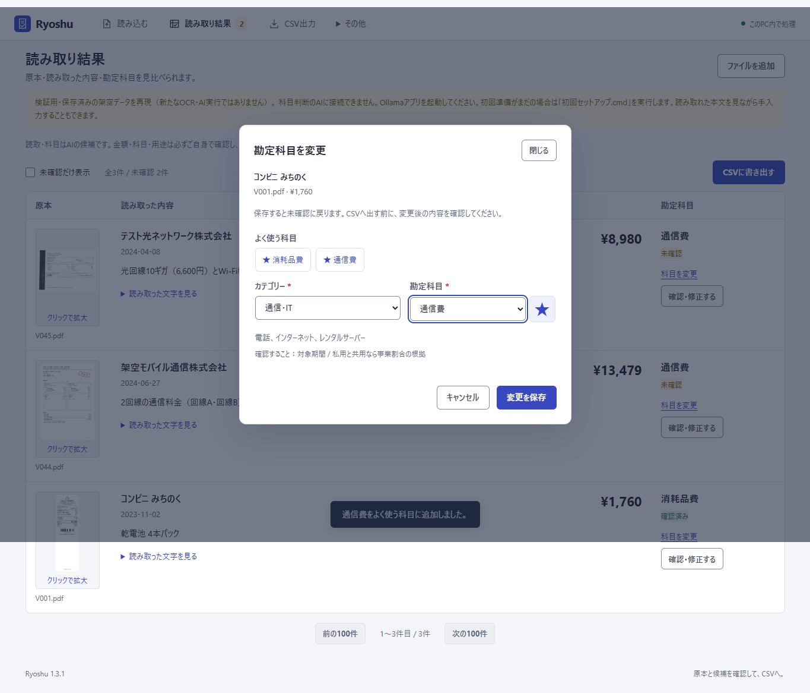

# v1.3.1：よく使う勘定科目にスターを付ける

[Ryoshuへ戻る](../../../README.md) / [科目の使い方](../../ACCOUNTS.md) / [v1.3.0の100件の検証結果](../v1.3/README.md)

## 追加した機能

科目横の☆を押すと、「よく使う科目」に登録できます。★を押すと解除します。結果一覧の「科目を変更」と詳細の確認・修正画面では、登録した科目のボタンからカテゴリーをまたいで選べます。「勘定科目一覧」からも付け外しでき、独自科目も対象です。

スターの付け外しは科目を選ぶための設定です。明細の勘定科目・未保存の入力・確認状態・仕訳・AI候補を変更しません。「よく使う科目」から別の科目を選んだ場合は通常の編集となり、保存操作が必要です。確認済み明細の科目を変更して保存すると、v1.3.0と同じく未確認に戻ります。

スターは科目名や別名ではなく、安定した科目コードで保存します。帳簿ごとの暗号化DBに含まれ、再起動と暗号化バックアップからの復元にも引き継がれます。ブラウザーだけの保存ではありません。DBスキーマは3のままです。

## 今回の検証対象

スターの登録・解除・再読込、独自科目と似た名前の区別、選べない科目の拒否、複数画面からの更新、セッションと同一オリジンの制限、暗号化バックアップからの復元を対象にします。ブラウザー検査では、両方の選択画面での操作、入力内容の保持、保存失敗からの再試行、キーボードのフォーカス、狭い画面での表示を確認対象にしています。

自動検査の入口は[保存・API・復元のテスト](../../../tests/test_account_favorites.py)と[ブラウザー操作のテスト](../../../scripts/account_favorites_smoke.mjs)です。ブラウザー検査に使う架空の観測値は操作確認用で、新しいOCR・AI推論の成功例には数えません。実行結果は[検証記録](verification.json)と[スター操作の記録](favorite-workflow.json)に残しています。Python264件・JavaScript5件、既存のブラウザー操作28項目・科目変更8項目・スター操作9項目が成功しました。

[375px幅・全科目にスターを付けた場合の表示](screenshots/04-all-favorites-mobile.png)も確認しています。これは表示・操作の負荷確認用で、通常はよく使う科目だけにスターを付けて使えます。

## 100件の数値はv1.3.0の記録

v1.3.1では、科目マスター69科目、OCR、意味判断モデルの入力・科目判定、CSV生成処理を変更していません。今回のスター追加のために100件を新規OCR・AI推論したとは扱いません。

公開している金額・円額未確定97/97（返金3件を除外）、日付99/100、暫定科目44/48は、[v1.3.0で100種類の架空PDFを新規処理した結果](../v1.3/README.md)です。元の期待値・観測値・不一致・点数・税額の事前評価範囲は変更していません。未知の実物領収書の正答率を示すものではありません。

v1.3.0の最終照合に使った57ファイルは、公開済みコミット`e79394d7349efc15aadb2dc02f6fe381596b407d`から[過去の処理ソース](../v1.3/processing-source.zip)として保存しています。テキストの改行は元の配布照合と同じ規則で正規化し、元の[最終照合JSON](../v1.3/finalization.json)に記録された各SHA-256、ZIPの範囲・CRC、元コミットを検査します。過去の最終照合や検証結果を最新版のソースで書き換えません。
