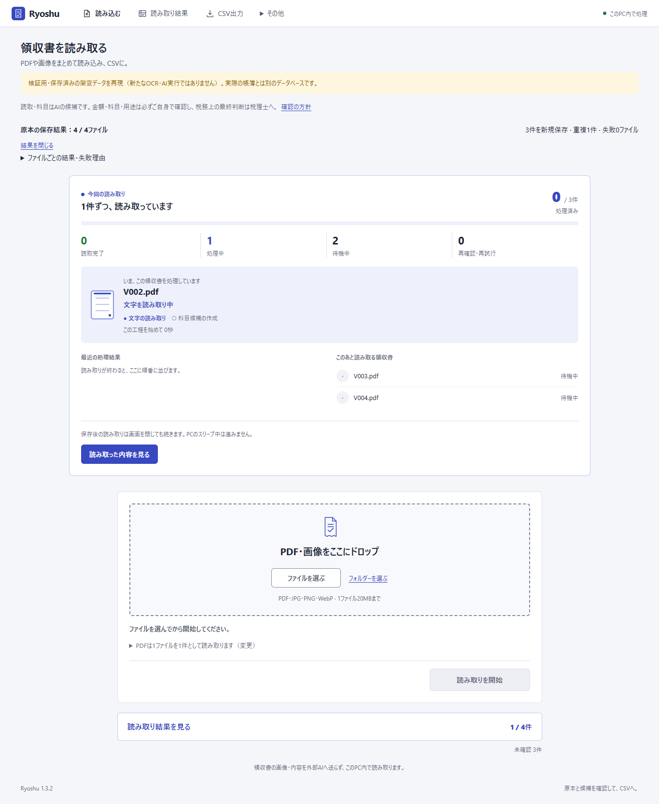
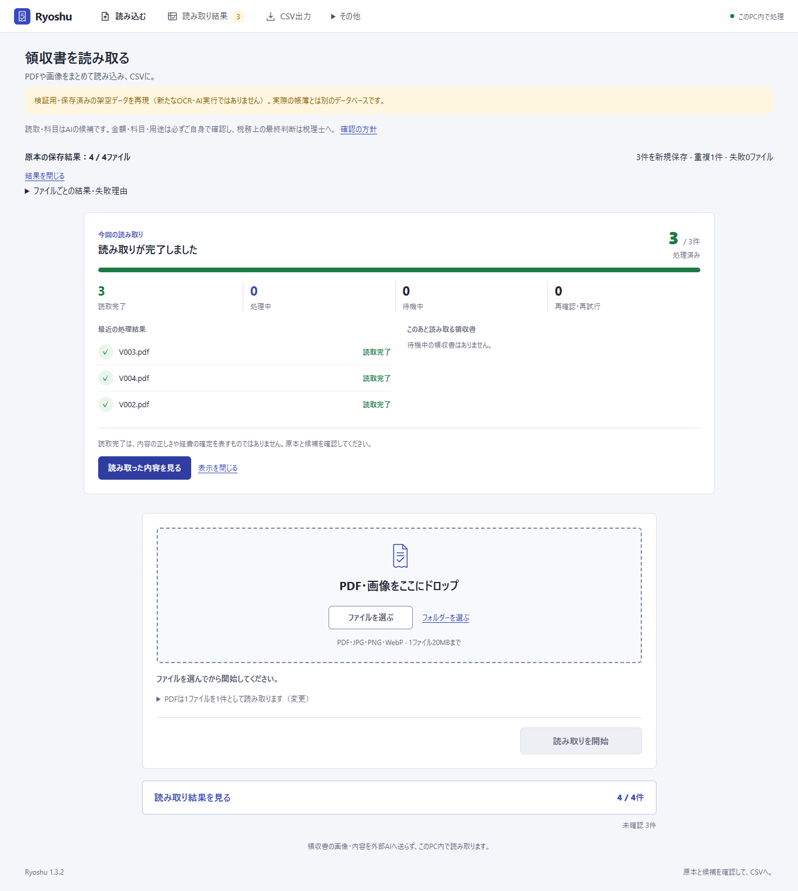
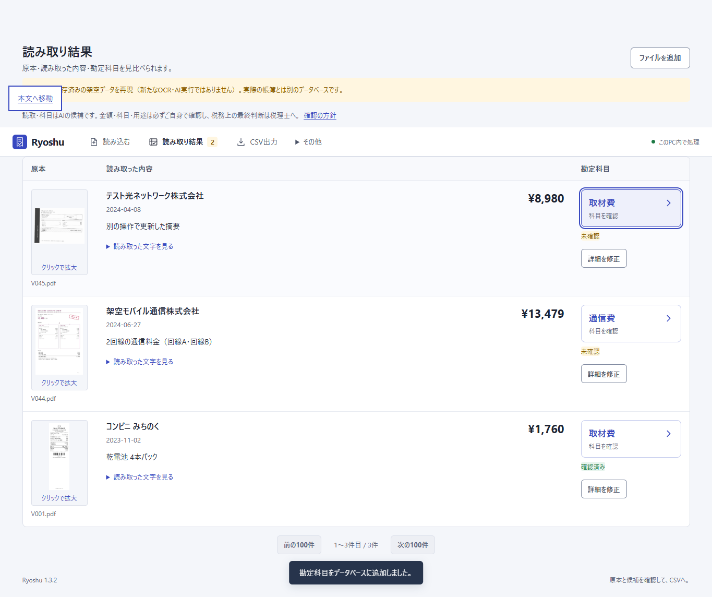
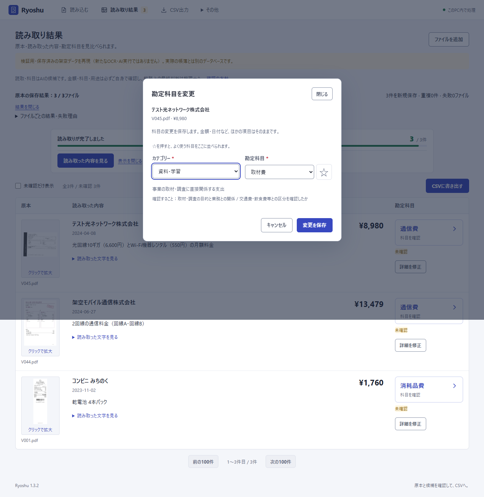

# v1.3.2：読み取り中の進捗・科目名からの変更・Windowsへの導入

[Ryoshuへ戻る](../../../README.md) / [導入手順](../../INSTALL.md) / [100件のOCR・科目判定結果（v1.3.0）](../v1.3/README.md)

読み取り中は、実際の明細の状態から処理中のファイル・段階・完了件数・待ち件数を表示します。原本の保存とOCRの完了を分け、読み取り完了と利用者の確認済みも分けます。過去の明細や重複を新しい処理の分母に含めません。再読込後は、その画面を開いた時点の残りの処理を表示します。

結果一覧では、科目名の大きなボタンからカテゴリー→勘定科目を選びます。未選択は「科目を選ぶ」、金額・日付・用途などの編集は「詳細を修正」です。確認済み明細の科目変更では未確認に戻し、以前の仕訳を履歴に残します。

Windowsインストーラーは利用者ごとにアプリを配置し、帳簿・原本の保存先と分離します。初回の実行環境・モデル取得にはネット接続とモデル利用条件の確認が必要です。

## 検証の区別

画面操作の検査は、保存済みの架空OCR・AI観測値を隔離した帳簿へ流し、実際のHTTP・画面・保存・CSVを通して行います。これは新しいOCR・AI推論の精度測定ではありません。元の100件の期待値・観測値・点数は変更しません。

OCR・科目判定・CSV生成・DBスキーマはv1.3.1から変更していません。金額・円額未確定97/97（返金3件を除外）、日付99/100、暫定科目44/48は、[v1.3.0の新規100件処理の結果](../v1.3/README.md)です。

## 実行結果

2026-10-25に、既存Pythonテスト264件、インストーラーの入力境界25件、JavaScript21件、ブラウザー操作75項目、CSV4形式が成功しました。[詳細・項目別の記録](verification.json)に検査対象のソースハッシュを残しています。

ブラウザー75項目の内訳は、通常操作28・保護と復元10・画面と導線8・科目変更10・スター9・処理中の表示10です。100PDFの一括選択、100ページPDFの分割、重複除外、失敗と再試行、通信断、一時停止・再開、再読込、未保存入力・フォーカスの保持、375px幅、動きを減らす設定を含みます。

独立レビューでは、取り込み一時停止中の表示、インストーラーの起動状態不明時の更新防止、Windows上のZIPパス判定を修正して再検証しました。実行した範囲でリリースを妨げる指摘は残っていません。各会計ソフトの実アカウントへのCSV取り込みや、初期状態の別PCでのモデル全ダウンロードは今回の検査には含みません。

## インストーラーの確認

配布候補を新しい隔離先へ実インストールし、ソースZIPとの全ファイル照合、3つのショートカット、PowerShell 5.1の起動確認、起動中の更新防止、別ポートでのアプリ起動、アンインストール後の暗号化帳簿・追加ファイルの保持を確認しました。自動試験はサイレント導入で行い、通常の帳簿は開きません。

最終配布EXEとソースZIPのハッシュ、最終EXEの実インストール結果は、[v1.3.2 Release](https://github.com/studio-yebisu/ryoshu/releases/tag/v1.3.2)の`SHA256SUMS.txt`・`verification.json`・`installer-verification.json`に添付します。初回のモデル・依存ダウンロードは既存の固定版セットアップを継承し、この導入試験では新規取得していません。

[再現用ビルド手順](../../../packaging/windows/README.md) / [実インストール検査](../../../scripts/verify_windows_package.py)
