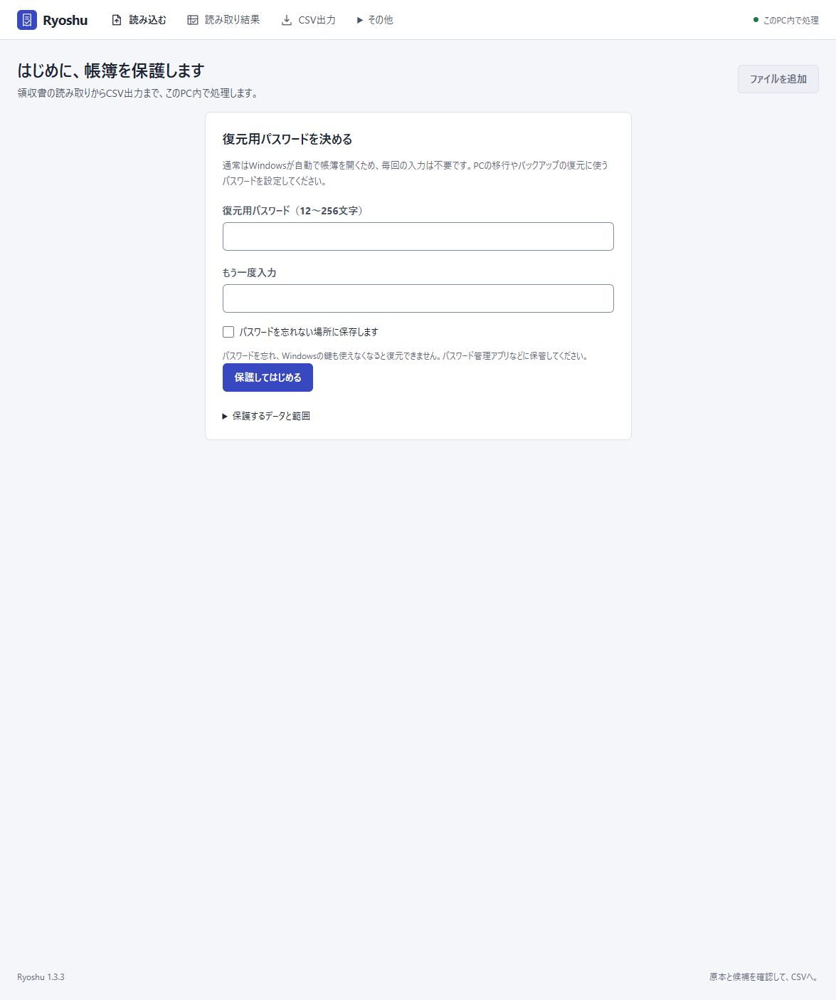

# v1.3.3：Windowsの実行環境と初回セットアップの修復

[Ryoshuへ戻る](../../../README.md) / [導入手順](../../INSTALL.md) / [Windowsパッケージの検査範囲](../../../packaging/windows/README.md) / [100件のOCR・科目判定結果（v1.3.0）](../v1.3/README.md)

2026-10-26のWindows起動修正の検証記録です。**実インストール先で初回準備・配布候補による更新・起動・再起動を確認し、ブラウザーで復元用パスワードの設定画面まで開きました。** 以下の実機確認は、ローカル修復と配布候補で行ったものです。最終の配布EXE・ソースZIPのハッシュと実インストール結果は、[v1.3.3 Release](https://github.com/studio-yebisu/ryoshu/releases/tag/v1.3.3)に添付する記録を参照してください。[検証の要約JSON](verification.json)

## 確認した症状と原因が未確定の範囲

提示された起動画面には、uvのPython起動用実行ファイルが参照先のPythonを見つけられないエラーが表示されていました。その後の実環境の検査では、共有の仮想環境にPython 3.12.9が残っており、必要なPython 3.12.15以降の3.12系・64bitを満たしていませんでした。一時的な参照先の欠落と旧版残存の関係や、参照先が見つからなくなった原因は確定していません。

旧実装はPython実行ファイルの存在を起動準備の判定に使う箇所がありました。配布EXEの導入検査も、別に用意した検証用Pythonでコードを起動していたため、通常起動で使うPythonの不備と初回セットアップの完了を検証できていませんでした。

## 修正内容

- 実際に使うPythonを起動し、バージョン・64bit・必要な暗号化ライブラリを共通の検査で確認します。参照先を起動できない場合、旧版の場合、ライブラリが不足する場合を区別します。
- 準備し直す仮想環境とアプリ専用Pythonは、許可した保存先だけを対象に別名で保存します。帳簿・原本・復元情報は移動・削除しません。参照先がリンクの場合は自動変更を止めます。
- Python 3.12.15をRyoshu専用の保存先へ準備します。他アプリのuv管理領域やグローバルなPythonのPATH・レジストリ登録は変更しません。
- 初回セットアップ開始時に`pending`を記録し、固定依存の導入・動作確認、OCRモデルの準備、Ollamaモデルの取得がすべて成功した後に`complete`へ更新します。完了記録は依存ロックのハッシュ・Python版・Pythonの参照先と照合し、中断や構成の変更後は準備を再開します。
- 実行環境の修復時は、起動中のRyoshuと別アプリのポート使用を区別して停止理由を表示します。帳簿や別アプリを自動終了しません。
- 復元した暗号化DBを認識して専用ランチャーを作成し、その保存先を指定して起動できるようにします。既存ランチャーは上書きしません。
- 初回の復元用パスワード設定前はDBがまだ存在しないため、保存先の記録をDB作成後に限定します。保護設定前の再利用・再起動を可能にし、記録済みまたは明示指定した帳簿が見つからない場合の拒否は維持します。
- 配布版の`-CheckOnly`も実際のPython・ライブラリを検査します。`python_prepared`はその検査結果であり、OCR・Ollamaモデルの準備完了とは別です。起動補助スクリプト3本の同梱をソースZIPの検査で必須にします。

実装の参照：[共通のPython・準備状態の検査](../../../scripts/python-runtime.ps1) / [初回セットアップ](../../../setup.ps1) / [通常起動](../../../start.ps1) / [復元先のランチャー作成](../../../scripts/launcher-process.ps1)

## 自動試験

Python全体は**349件が195.06秒で成功**しました。最終の収集件数も349件で、[初回準備・実行環境の47件](../../../tests/test_runtime_bootstrap.py)を含みます。起動に関連する47件と[ランチャーの8件](../../../tests/test_launchers.py)を合わせた55件も、別に51.41秒で成功しました。

| 対象 | 結果 | 確認した範囲 |
| --- | ---: | --- |
| Python全体 | 349件成功 | 実行不能・旧版・不足ライブラリ、旧環境と架空データの保全、中断と再試行、保護設定前の再利用・再起動、平文・暗号化DBの保存先、記録済み・明示指定したDBの欠落時の拒否を含む |
| [配布版の診断](../../../tests/test_installed_readiness.py)・[パッケージ入力](../../../tests/test_windows_package.py) | 36件成功 | 隔離プロファイルの実際の欠落・実行不能Python、検査結果のJSON、補助スクリプト欠落時の拒否、危険なZIPパスと私的データの拒否 |
| JavaScript | 21件成功 | 既存の画面処理の回帰試験 |
| [公開用ソースの整合検査](../../../scripts/check_publication.py) | 527ファイル成功 | 公開対象・必要ファイル・版表示の一致 |

配布版診断・パッケージ入力の36件はPython全体に含まれ、合計へ再加算していません。Windows PowerShellを使う自動試験は隔離したプロファイルで実行し、通常の帳簿を開きません。ネット取得・モデル準備・起動中プロセスを制御用の代替処理で再現する箇所があり、実機確認とは分けています。

## 実環境での確認状況

実インストール先のセットアップで、固定版uv 0.13.5を取得し、旧Python 3.12.9の仮想環境を別名で保存してRyoshu専用Python 3.12.15を準備しました。グローバルなuvのリンク先は3.12.9のままで、変更していません。

依存の導入、Indra OCR 1.1.2のCPUExecutionProviderによる準備、OllamaのQwenモデル取得がすべて成功し、準備状態の`complete`記録を確認しました。新しい仮想環境のcryptographyは50.0.2、SQLCipherが使うSQLiteは3.53.4でした。実行前後に照合した保全対象の既存ファイル2件は、ハッシュが一致しています。全帳簿・全原本を網羅した照合を示す件数ではありません。

ローカル修復後に、既存インストール先の起動・再利用・終了・停止後の再起動がすべて終了コード0になりました。その後、1.3.3の配布候補EXEで同じ既存アプリを更新し、**同梱525ファイルがソースZIPとバイト単位で一致**することを確認しました。次はこの1台での配布候補の実行記録です。

| 操作 | 実行時間 |
| --- | ---: |
| 既存アプリへの更新 | 11.847秒・終了コード0 |
| 起動 | 7.812秒・終了コード0 |
| 起動済みサーバーの再利用 | 3.447秒・終了コード0 |

通常の起動CLIから作られる認証付きリンクで開き、復元用パスワードの設定画面を実際に確認しました。パスワードは入力せず、本人による設定へ引き継ぎます。画面の版表記も修正し、公開用ソースの検査でアプリ・パッケージ・画面の版を照合しています。

完了記録が無い場合の自動再開も、実インストール先の通常起動から確認しました。依存・OCR・Ollamaの準備を再実行してから起動し、10.964秒・終了コード0、続く再利用も終了コード0でした。モデルキャッシュは既存のものを使用しています。

この候補の実機確認と、最終ソースを凍結して再作成した配布EXEの照合は区別します。最終配布物の組み合わせと結果は、[v1.3.3 Release](https://github.com/studio-yebisu/ryoshu/releases/tag/v1.3.3)のハッシュ・実インストール検証記録を参照してください。

## 検証の限界

初期状態の別のWindows PCへのクリーンインストールは未検証です。今回の実環境には既存のOllamaやモデル等があり、新しいPCでの全ダウンロード時間や動作を保証するものではありません。利用者の実インストール環境を使った全アンインストール試験も行っていません。

OCR・科目判定・CSV生成・DBスキーマは変更していません。新しい100件のOCR・AI推論や、依存全体の新しいセキュリティ監査は実施していません。[v1.3.0の100件の結果](../v1.3/README.md)と過去の安全性点検は、それぞれの時点の記録です。
