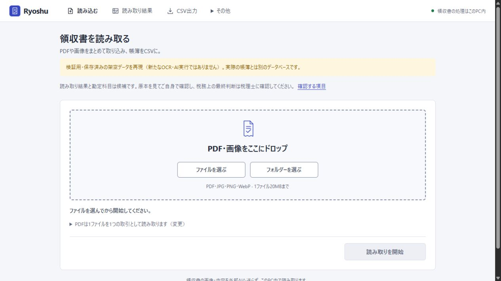
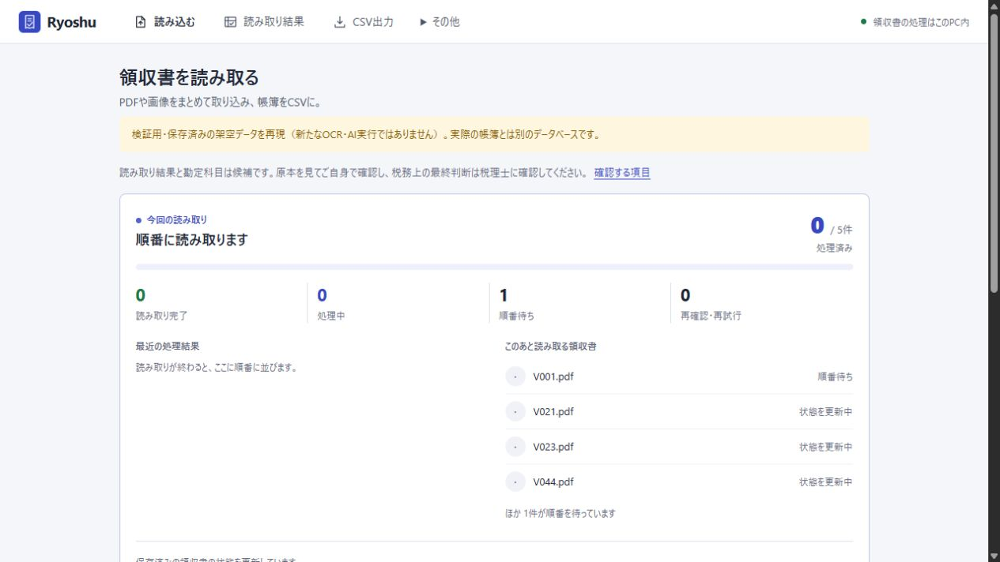
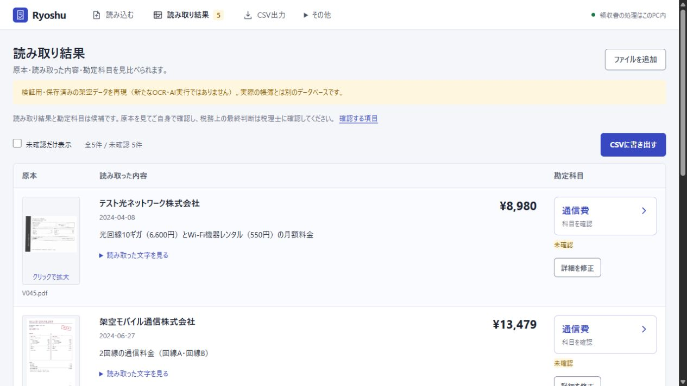
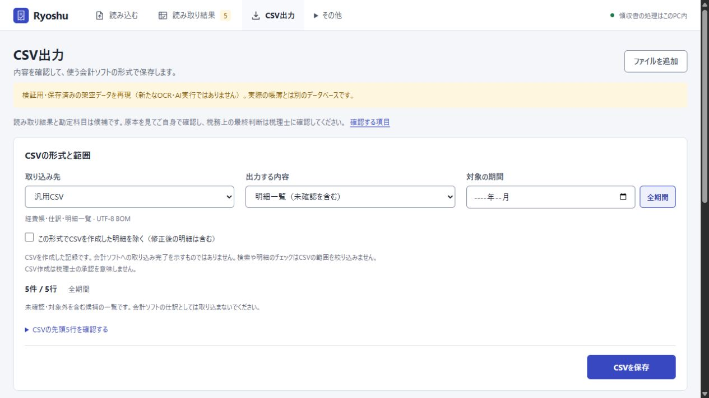
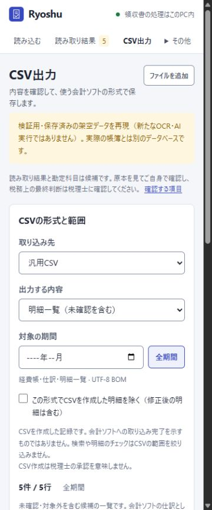
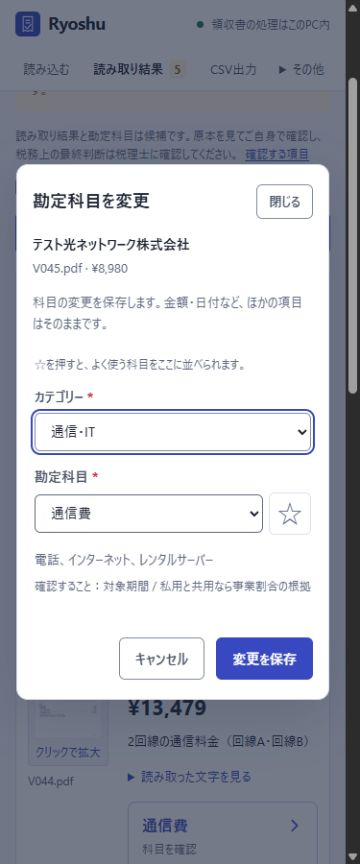

# v1.3.4：Windows起動と画面導線の修正

[Ryoshuへ戻る](../../../README.md) / [導入手順](../../INSTALL.md) / [前版の記録](../v1.3.3/README.md) / [100件のOCR・科目判定結果（v1.3.0）](../v1.3/README.md)

Windowsの準備・起動、画面の日本語、配置、移動時の入力保持を確認した記録です。[検査の要約JSON](tests.json)、[手動の画面確認](manual-browser.json)、[モデルへの相談と採否](reviews.json)を公開しています。

## 直したこと

- PowerShell 7のモジュール検索設定を引き継いだWindows PowerShellで、`Get-FileHash`が見つからず準備・起動が止まる問題を修正。準備状態とuvの照合を、共通の.NET SHA-256処理に変更しました。
- 「未確認」「支払元」「事業割合」などの呼び方を整理し、復元用パスワードの説明も実際の操作に合わせました。汎用CSVの状態名など、既存の出力値は互換性のため保持しています。
- 完了表示の重複を減らし、ホームと進捗カードの幅・パネルの余白・ボタンの高さを統一。CSVの保存ボタンを入力欄と別の行に置きました。
- 開始時だけ進捗が見える位置へ移動。通常の更新は閲覧位置を動かしません。待機後に新しい読み取りを始めると誤って接続警告が出る問題も修正しました。
- 詳細から戻ると、元の画面・期間・検索・表示位置・明細ボタンへ戻ります。古い取得応答が、開き直した明細や入力中の内容を上書きしないようにしました。

## 実行した検査

| 対象 | 結果・範囲 |
| --- | --- |
| Python全体 | **354件成功**、失敗・スキップ0。Windowsの暗号化対応テスト環境で実行 |
| JavaScript | **29件成功**。取り込み、科目、進捗、遅れて届く応答と入力保護 |
| CSV4形式 | 架空6明細から7行、借方・貸方とも299,095円。生成・再読込・借貸一致を確認。[記録](csv-verification.json) |
| 手動の画面操作 | **Codexのサイドブラウザーのみ**。別の暗号化DBに架空PDFを取り込み、科目選択・スター・CSV保存・戻る操作・375px幅を確認 |
| CI | [PR #10のChecks](https://github.com/studio-yebisu/ryoshu/pull/10/checks)。Windowsの全検査と6種類の画面操作検査。リモートの検査で保存済み架空データを再現 |
| 配布物・起動 | [v1.3.4 Release](https://github.com/studio-yebisu/ryoshu/releases/tag/v1.3.4)添付の`runtime-verification.json`に、EXE・ZIP・同梱ファイルの照合と実インストール先の起動範囲を記録 |

画面検査は保存済みの架空データを再現したものです。**新しいOCR・AIの推論精度試験ではありません。** 科目マスター・OCR・科目候補の生成方法・仕訳計算・CSV形式は変更していません。

## 日本語と画面のレビュー

Kimiの`kimi-code/k3.1-pro`ルートで公開ソースを8区画に分けて確認し、用語・復元手順・説明文を整理しました。CLIの指定先は確認していますが、サーバーが返す上流モデルIDは取得できていません。

Opus 5.5へ公開ソースと架空データの画面を渡して相談しました。修正後11画像の見える範囲ではP1/P2の崩れの指摘はありませんでした。ソースレビューの「元画面を保持しない方がよい」という候補は、実在しない入口を仮定していたため採用せず、CSVへ戻れる動作を保持しています。後から追加した応答の保護などは、モデルが見た範囲と分けてテストしました。

レビューは操作検査や公開承認の代わりにはしていません。利用者の帳簿・認証情報はレビューへ渡していません。[モデル・入力ハッシュ・採否](reviews.json)

## サイドブラウザーの画面

以下は最新版の別DBで、保存済み架空データを再現した画面です。黄色の帯は検証環境であることを示します。

## 今回保証していない範囲

元のuvエラー文面そのものの完全一致は再現できていません。参照先Pythonが欠けた仮想環境の修復と、別に再現したPowerShellのハッシュ取得失敗を区別しています。

既存のWindows PC・Ollama・モデルキャッシュを使用しており、別の初期状態のPCでの検証ではありません。サイドブラウザー限定の指示以降は、通常ブラウザーを開く元のショートカットによる全初回準備を再試験していません。実インストール先の起動はブラウザー自動表示を止め、画面をサイドブラウザーで確認する範囲です。

新しい100件の推論検証は実施していません。[v1.3.0の結果と除外条件](../v1.3/README.md)を保持しています。会計ソフト各社の実アカウントへのCSV取り込みも未検証です。
