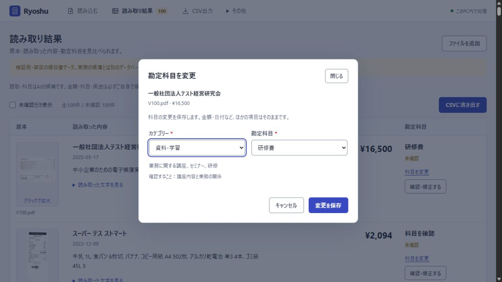

# v1.3.0：科目の2段階選択と100件の再検証

[Ryoshuへ戻る](../../../README.md) / **[原本・読み取り・科目を並べて見る](index.html)** / [全100件の画像](../gallery.md) / [比較CSV](comparison-100.csv) / [結果JSON](results-100.json)

## 科目を探して変更する

結果一覧の**「科目を変更」**から、**カテゴリー→勘定科目**の順に選んで保存できます。金額・日付・用途・事業割合・支払元など、科目以外の入力は保持します。「確認・修正する」を開いた場合も同じ2段階選択です。

初期データを38科目から74科目へ増やしました。このうち領収書に選べる経費・仕入・資産は**33科目から69科目（経費49・資産20）**となり、**13カテゴリー**で絞り込めます。残る5科目は支払元・事業主勘定等です。カテゴリーの定義はこれらを含めて14ですが、支出の選択画面には13カテゴリーを表示します。[カテゴリー別の全科目と対象範囲](../../ACCOUNTS.md)

カテゴリーを変えただけでは先頭の科目を自動設定しません。科目を明示してから保存します。独自科目もカテゴリー付きで追加できます。カテゴリーは探すための分類であり、補助科目ではありません。CSVには正式な勘定科目名を出します。

確認済みの明細で科目を変えると、**未確認に戻り、再確認するまで確認済みのCSVから外れます**。以前の仕訳は無効化して履歴に残し、再確認後に新しい仕訳を作ります。別画面との更新競合では入力した選択を保持し、最新の内容を読み直すよう案内します。

## 100件の結果

2026-10-23に処理する候補を固定し、**100種類の架空PDFをHTTP取込→Indra OCR→PC内のQwenによる科目候補まで新規実行**しました。保存済みのOCR・AI出力は再利用していません。

| 項目 | v1.3.0 | v1.2.0の記録 |
| --- | ---: | ---: |
| OCR完了 | 100/100 | 100/100 |
| ローカル意味判断モデル完了 | 100/100 | 100/100 |
| 金額・円額未確定 | **97/97** | 97/97 |
| 日付 | **99/100** | 99/100 |
| 支払先 | 86/100 | 86/100 |
| 暫定科目が許容候補と一致 | **44/48** | 47/48 |
| 提案・保留・停止・資産検討 | 93/100 | 93/100 |
| 科目または保留条件 | 86/100 | 89/100 |

金額の分母は、非負の円額95件と、外貨で円額未確定の2件です。**返金V019・V080・V097の3件は金額の評価から除外**しています。返金処理が正しいという意味ではなく、返金・外貨の仕訳は未対応です。

暫定科目の48件は、元の期待値で科目提案を求めるケースです。不一致の4件は次のとおりです。

| ケース | 元の許容科目 | v1.3の候補 | v1.2との違い |
| --- | --- | --- | --- |
| V032 | 外注費 | 外注工賃 | 候補は同じ。外注費を独立した正式科目として区別したため不一致 |
| V067 | 賃借料・外注費 | 外注工賃 | 候補は同じ。上記と同じ照合上の違い |
| V073 | 研修費・教育研修費 | 空欄・確認待ち | 年間契約の期間配分を確認するため保留。v1.2も同じ |
| V093 | 外注費・広告宣伝費・支払手数料 | 外注工賃 | 候補は同じ。外注費を独立した正式科目として区別したため不一致 |

**暫定科目は旧版の47/48から44/48、複合条件は89/100から86/100になりました。** 新たに不一致となった3件の候補は旧版と同じ外注工賃ですが、旧版では外注費を外注工賃の別名として照合していました。今回は別々の正式科目として扱い、不一致をそのまま公開しています。V050のリース支払は賃借料から新しい正式科目のリース料へ変わり、元の許容候補と一致しました。

日付の不一致はV011で、元の期待値の納品日2024-05-22に対し、発行日2024-05-20を出力しました。支払先の一致は86/100のままで、V058の表記は変わりましたが一致にはなっていません。各差異は[比較CSV](comparison-100.csv)と[100件の表示](index.html)で確認できます。

「科目または保留条件」の不一致は**V003・V006・V013・V029・V032・V059・V060・V067・V073・V074・V078・V087・V093・V095の14件**です。元の期待値は`hold`の場合に科目の空欄も要求します。そのため、V006・V074・V087・V095のように確認待ちでも科目候補が残る場合は不一致です。V003・V013・V029は期待する保留に対して暫定提案、V059・V060・V078は保留に対して登録停止、V073は提案に対して保留でした。これらの扱いはv1.2と同じです。

## 税額は事前指定した63件を別途確認

税額は100件全体の正答率にせず、実行前から固定した[63件の期待値](tax-scope-expectations.json)で評価しました。数値が印字されている52件と、全体の税額が未印字等で空欄にすべき11件を分けています。

| 確認内容 | 結果 |
| --- | ---: |
| 印字税額の数値一致 | 51/52 |
| 空欄を期待したケースの一致 | 11/11 |
| 数値を期待したが空欄だったケース | 1件（V013） |
| 誤った数値を出したケース | 0件 |
| 未評価の通常円支出で数値を出したケース | 0件 |
| 事前除外の返金で数値候補が残るケース | 3件（登録停止） |

V013には553円の税額が印字されていますが、税額ラベルのOCRが崩れ、数字を税額として特定できず空欄になりました。数値一致には数えていません。V044は領収書全体の税額が印字されていないため、明細行の653円を全体の税額として採らず空欄にしています。税額の数値・空欄は、v1.2の100件と同じ結果でした。

**返金V019・V080・V097と外貨V038・V084は、実行前から通常円取引の税額評価から除外**しています。返金3件には税額候補134円・1,350円・3,000円が残りますが、すべて登録停止（`block`）で、税額の成功件数には数えません。事前に確認範囲を付けていない残りのケースも、一致に加算していません。

## 実行範囲と期待値

元の[100件の架空PDFと期待値](../../../samples/receipts-100-v2/manifest.json)は変更していません。事務用品費・販売促進費・外注費・リース料・支払利息は、旧版の別名から独立した正式科目になりました。元の許容候補も新しいマスターで照合するため、以前は同じ科目に解決していた名前を区別します。この違いで不一致になった場合も、後から許容候補を増やしたり、説明を付けて一致に加算したりしていません。版をまたぐ科目の点数は、この照合上の違いを含みます。

全件共通の事業概要を渡しましたが、ケースID・期待値・各件の業務背景はモデルに渡していません。全100件とも未確認、仕訳0行の状態で採点しています。画面撮影でも科目を保存せず、推論後の候補を保持しました。

先に実行した別の候補は、独立レビューの指摘を受けて23件で中断しました。この部分結果は集計から除外し、修正後の候補で100件を最初から処理しています。保存済みOCRやAI候補の流用はありません。

**改善に使った同じ100件の回帰検証であり、未知の実物領収書の正答率ではありません。** 科目を増やしたことと、自動判定の精度が上がることは別です。**原本・金額・科目・用途は利用者が必ず確認し、税務上の最終判断は税理士に確認してください。** 摘要にも原本にない表現が残る場合があり、確認が必要です。

## 実行環境と再現できる範囲

- Windows 11、AMD Ryzen 9 7950X3D、RAM 64GB、Python 3.12.15。
- Indra OCR 1.1.2、CPUExecutionProvider。OCR重みrevisionは`bd02167fdf2005a19962cc15188f8496a2c87d3b`。
- Qwen3 4B / Q4_K_M、Ollama 0.40.7。モデルdigestは`359d7dd4bcdab3d86b87d73ac27966f4dbb9f5efdfcc75d34a8764a09474fae7`。
- モデル設定はtemperature 0、seed 42、CPU・6スレッド、コンテキスト8192、出力上限850トークン。準備済みのOCR重みを使い、OCRモデルのダウンロードを無効にして実行しました。
- 実行時間は1,373.6秒、約22分54秒。この1台・同じ架空100件での記録であり、一般の処理速度保証ではありません。
- 凍結実行のソースは`71e2db4d0d27e600e3eead9b792dd1c8c2f0bde6`。実行時ファイルとモデル入力方針は[結果JSON](results-100.json)に記録しています。

[結果JSON](results-100.json)は、期待値・観測値・OCR本文・科目候補・理由・一致条件・PDFハッシュを公開用に抽出したものです。利用者パス、内部receipt ID、実行ポート、認証情報は含めません。凍結した`receipt_ledger`・`data`・`web`の各ファイルを、配布候補とGitの改行正規化後のハッシュで照合しています。[最終照合と画面の出典](finalization.json)

## 画面・保存・CSVの確認

科目変更の[ブラウザー8項目](account-workflow.json)では、カテゴリーによる選択肢の絞り込み、明示的な科目選択、Escapeによる取消とフォーカス復帰、保存後の再読込、科目以外の入力保全、更新競合、確認済み仕訳の無効化と履歴、詳細画面の未保存入力保護を確認しました。独自科目の追加と4形式の実CSV応答も対象です。[375px幅の選択画面](screenshots/03-mobile-picker-ui-check.png)は編集操作を試すために架空の観測値を再現したもので、科目判定の正答例ではありません。

既存の[通常操作28項目](browser-workflow.json)、[初回保護・原本拡大・保存・復元10項目](security-ui-workflow.json)、[期間選択・フォーカス・画面幅等8項目](ux-workflow.json)も再実行しました。これらの画面検査ではHTTP、保存、暗号化、CSV、復元は実処理を使い、OCR・モデルは保存済みの架空結果を再現しています。新規100件の推論とは別の検査です。OSの保存ダイアログそのものは対象外です。

別の架空6件を期待値で手動確認し、実APIから**汎用・freee・MFクラウド・弥生の4形式**を生成してCSVとして読み直しました。7仕訳行、借貸とも299,095円で一致しました。[検査JSON](csv-verification.json) / [CSV仕様](../../CSV-EXPORT.md)

[汎用の出力例](csv/qa-exempt-generic-journal.csv) / [freeeの出力例](csv/qa-exempt-freee-journal.csv) / [MFクラウドの出力例](csv/qa-exempt-mf-journal.csv) / [弥生の出力例](csv/qa-exempt-yayoi-journal.csv)。架空データなので実際の帳簿へ取り込まないでください。**各会計ソフトの実アカウントへの取り込みは未実施**です。

## レビューと回帰検査

Opus 5.5は、開発中の初期候補のソース差分をレビューしました。提示した範囲ではP1・P2の指摘はありませんでしたが、ツール・ブラウザー・テストを実行したレビューではありません。

その後の独立レビューで、**以前から登録されていた独自科目の正式名が、新しく追加した初期科目コードと同じ場合に誤解決する問題**が見つかりました。バックエンドと画面の両方で「すべての正式名→すべてのコード→別名」の順に照合するよう修正しています。E129・A106という独自科目名を持つ旧DBの移行、保存、確認済み仕訳の保持を回帰検査に加えました。新しく独立した正式科目が古い別名に吸収される画面側の問題も修正しています。

この最終修正はOpusの初期差分レビューの後に行い、実行検査で確認しました。**モデルがアプリ全体や最終版を承認したという意味ではありません。** レビューに渡したのは公開ソースで、実際の帳簿は外部へ送っていません。アプリの実行時に外部AIを使う機能もありません。[モデル・応答ハッシュ・範囲・対応](reviews.json)

**Python全256検査、JavaScript5検査**が成功しました。上記の画面操作とCSVを含む範囲・時間は[試験項目](tests.json)と[最終の統合状態](finalization.json)に記録しています。GitHub Actions・mainの統合・配布ZIPの検査は別の公開工程です。

## 更新時の保全と残る制約

DBはカテゴリーを保存するスキーマ3へ移行します。更新前の暗号化スナップショットを保存し、既存の正式科目名・コード・別名、利用者の修正、独自科目、確認済み仕訳を保持します。**更新したDBを旧アプリで開くことはできません。** 旧版へ戻すときは、更新前のバックアップを別の保存先へ復元してください。[更新・復元手順](../../INSTALL.md)

1枚の領収書につき1つの経費・資産科目を扱います。補助科目、品目別の複数科目分割、減価償却・決算・申告の計算は対象外です。資産の選択肢を増やしたことは、償却や期末調整の自動化を意味しません。業務用途、家事按分、資産・前払・棚卸の扱いは確認してください。[科目の範囲](../../ACCOUNTS.md)

外部AIを使わず、PC内でOCR・科目候補・CSVを処理します。DB・保存済み原本・プレビュー・バックアップの暗号化は継続しています。**書き出したCSV・原本は通常の平文ファイルです。** 同じWindowsアカウントの不正ソフト、管理者権限、開いた画面、OSの一時領域、移行前のディスク領域は保存時暗号化の保護範囲外です。[保護方式と制約](../../SECURITY-DESIGN.md)

依存ライブラリ・同梱ネイティブコードの点検は[v1.1時点の記録](../security/README.md#依存ライブラリの点検と残る制約)を参照してください。今回の変更で依存は増やしておらず、新しい全体監査や脆弱性がないことの保証はしていません。[v1.2のHTTP18項目](../v1.2/http-security.json)も過去の記録であり、今回の再実行数には含めません。

新しいPCへのクリーンインストール、代表的な利用者による使いやすさ調査、会計ソフトの実アカウントへの取込、網羅的な安全性・アクセシビリティ認証は今回の検査対象外です。

[v1.2.0の結果・税額修正](../v1.2/README.md) / [v1.1.0候補の結果・安全性点検](../security/README.md) / [v1.0.0候補の結果](../v1/README.md)
