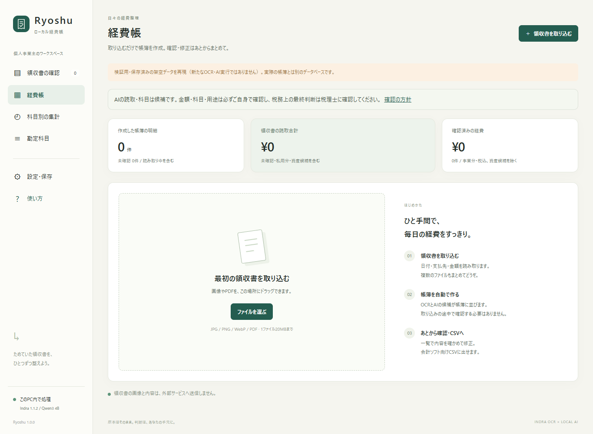
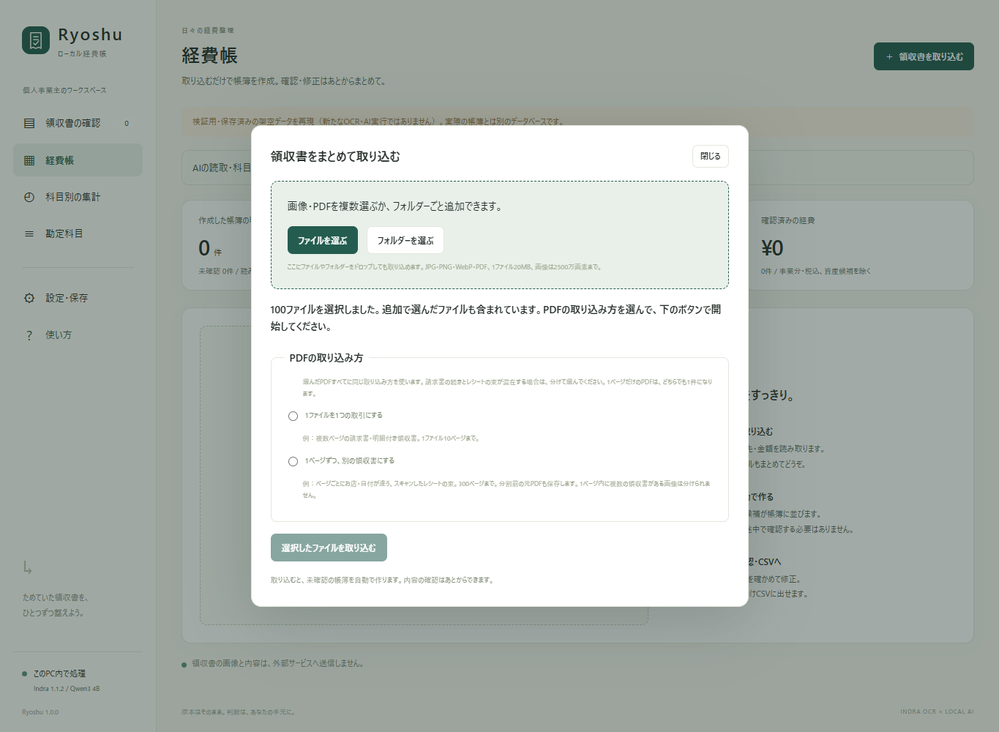
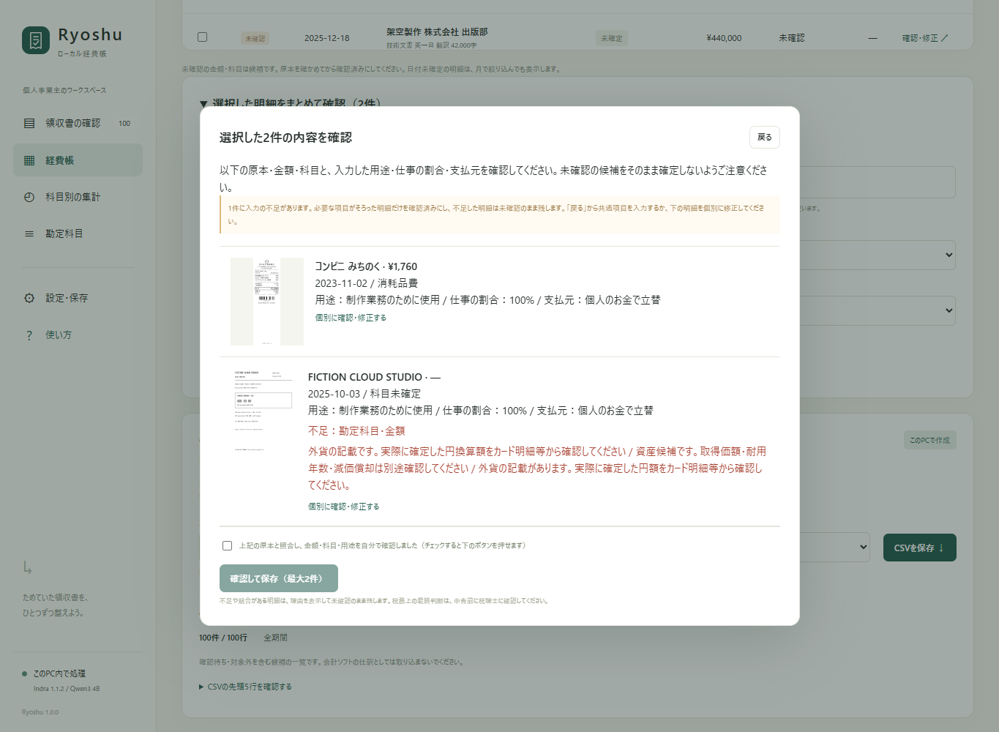
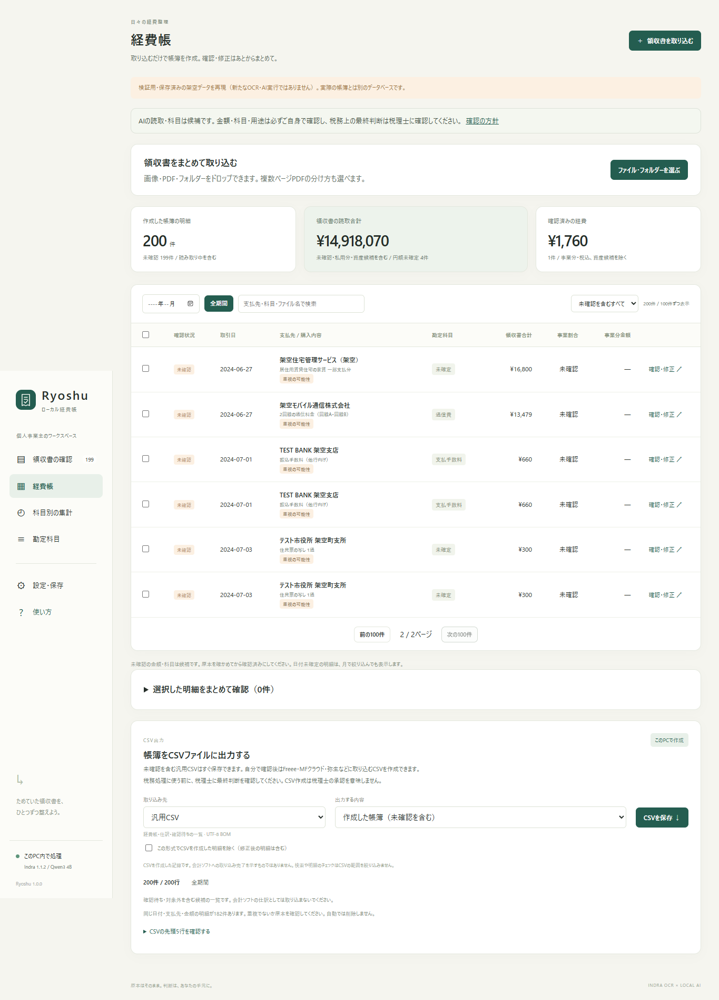

# v1.0.0の改善・レビュー・検証

[README](../../../README.md) / [開発時の100件のOCR・AI結果](../README.md)

v1.0.0では一括取り込み・あとからの確認・CSV・復元を改善しました。本人が原本と科目を確認し、税務上の最終判断は税理士に確認する[利用方針](../../REVIEW-POLICY.md)を画面にも表示します。適法性の専門家審査を受けたという意味ではありません。

## 検査結果

2026-10-22時点のローカル検査です。GitHub Actionsの結果や、新たなOCR・AI実行の結果とは区別します。

[候補1025426当時の検査状況](check-status.json)と[その候補ZIPの検査](package-check.json)は履歴として保持します。下表と新しい実行記録が今回の検証です。最終配布ZIPとSHA-256は[GitHubリリース](https://github.com/studio-yebisu/ryoshu/releases/tag/v1.0.0)に掲載します。

| 検査 | 結果 | 対象 |
| --- | --- | --- |
| Pythonの単体・API検査 | 130件成功 | 確認条件、返金根拠、居住用家賃と保険の区別、既存明細の注意更新、同時・部分取り込み、再開、移行、CSV、バックアップ・復元など |
| フォルダー読み取り | 3件成功 | 100件を超える列挙、入れ子、読み取り失敗、空フォルダー |
| 実ブラウザー操作 | 26項目成功 | 100ファイル、100ページPDF、帳簿202件で操作。OCR・AI結果は保存済みデータの再現 |
| CSV統合検査 | 4形式成功 | 架空6件・7仕訳行、借貸とも299,095円。免税個人事業主として手動確認したシナリオ |
| PowerShell構文 | 5本成功 | 導入・起動・終了・復元と起動管理の補助スクリプト |
| 実Windows起動・終了 | 成功 | 空の専用帳簿で起動・再起動要求・接続記録欠落からの復旧・終了。通常の帳簿は変更せず、Ollamaと別の検証サーバーは継続 |
| 公開内容の点検 | 成功 | 元の100原本と期待値・集計、処理ソースの変更記録、リンク、公開対象を照合 |

再現手順は[開発用の操作検査](../../../CONTRIBUTING.md#ブラウザーでの操作検査)、機械可読の操作結果は[browser-result.json](browser-result.json)です。画面検査は実際にHTTP・原本保存・SQLite・CSVを使いますが、OCR・AIは呼びません。2000ファイルの検査は空ファイルの結果表示を使い、閉じたときは詳細行を描画せず、開いても100行に抑えることを確認しました。2000件の実OCR速度や、OSの日本語IME自体の検証ではありません。

[科目の細分化・大量取り込みの原典調査](RESEARCH.md)では、imozuruを用いたOpusの調査と、取得できなかった範囲を記録しています。勘定科目の内訳と品目分割を区別し、未実装の操作を案内する文言も修正しました。

モデルが停止した状態で行った別の再検査では、100件のOCRが完了し、AI実行は0/100でした。通常のOCR・AI検証の成功として扱いません。検査スクリプトには、AIの準備ができていなければ取り込み前に終了する確認を追加しました。その後、Ollamaを起動した環境で通常のローカルAIを含む100件の再実行を2回完了しました。結果は以下へ分けて記録します。

## 100件のOCR・AI再実行

原本PDFを新規にHTTPで取り込み、Indra OCRとローカルQwen3 4Bを実行しました。保存済みOCRの流用はありません。期待値・ケースID・ケース別の説明は推論に渡さず、採点側だけで参照しています。本人確認・手動補正・仕訳登録は行っていません。

| 指標 | 家賃修正前 | 家賃修正後 |
| --- | --- | --- |
| OCR / ローカルAI実行完了 | 100/100・100/100 | 100/100・100/100 |
| 金額・円額未確定 | 97/97 | 97/97 |
| 日付 | 99/100 | 99/100 |
| 支払先名 | 86/100 | 86/100 |
| 科目または保留条件 | 88/100 | 89/100 |
| 提案・保留・資産検討・停止 | 92/100 | 93/100 |
| 暫定科目（提案を期待した48件） | 47/48 | 47/48 |

金額97件の内訳は非負の円額95件と、外貨で円額未確定の2件。返金V019・V080・V097の3件を分母から除いています。**同じ架空100件を改善にも用いた回帰検査で、未知の実領収書での正答率ではありません。**

初回はV052の居住用家賃を、0円の駐車場明細から旅費交通費と提案しました。一般条件として居住用家賃を用途・按分確認まで保留する修正を加え、再び100件を実行してV052が保留になることを確認しました。期待値と原本は変更していません。

- [修正前の100件と実行ソース](ocr-ai-100-before-fix.json) / [修正後の100件と実行ソース](ocr-ai-100.json) / [比較CSV](comparison-100.csv)
- [変更した判定と科目データ差分の確認](ocr-ai-comparison.json)。全100件はコミット9e06ef6・シード2026-10-22.1で実行。その後の2026-10-22.2は住宅向け火災保険の誤検知を避ける変更で、100件の実OCR根拠へ両条件を適用した結果の差は0件でした。これは保存済み根拠の条件照合で、新たな推論ではありません。
- 最終の科目データではV052・V053・V054を原本から再読取し、家賃の保留と2件の保険の候補を追加確認しています。[最終3件の実行記録](ocr-final-spot.json)

残った差異を加点で隠していません。日付V011は期待値の納品日5/22に対し発行日5/20を読み、未払いとして停止しています。V003・V013・V029は用途確認を期待する原本に科目を提案しますが、アプリ内ではすべて未確認の下書きです。V006・V074・V087・V095は日付欠落により保留しながら科目候補を保持するため、科目の空欄も要求する期待値とは一致しません。V059・V060・V078は保留より強い停止、V073は年額研修の期間配分を確認する保留です。支払先名の14差異も、空白等を正規化した厳密比較のまま全件JSONに残しています。これらを税務判断の正しさとして認定したものではありません。

基本の通信費は携帯・固定回線・クラウド・ドメイン・ホスティングの5件で通信費の候補が一致しました。年額SaaSは期間の確認を優先して保留しています。初期38科目の内訳は[科目一覧](../../ACCOUNTS.md)を参照してください。

## 画面で確認できること

すべて架空データの検証用画面です。保存済みのOCR・AI結果を再現していることを、画面上部にも表示します。

| 最初の画面 | PDFの取り込み方 |
| --- | --- |
|  |  |

| あとからまとめて確認 | 作成した帳簿 |
| --- | --- |
|  |  |

[375px幅の画面](screenshots/mobile.png) / [2000ファイルの結果を100件ずつ表示](screenshots/result-pages.png)

[11ページ以上のPDFを取り込み直す案内](screenshots/pdf-remedy.png)は、ファイル別の詳細を開かなくても表示します。一括確認で残った理由は名前付きで保持し、1件開いて帳簿へ戻っても確認できます。結果の保持は同じブラウザータブ内です。[2回目の100件処理で通信を切った画面](screenshots/interrupted-batch.png)では、保存済みの明細を残し、未処理分を名前付きで案内することも確認しました。

## 大量データの測定

合成した2000明細・1件あたり約104KBのOCR JSONを使い、SQLiteとASGI経由のAPI応答を3回ずつ測定しました。一覧の中央値250.7ms、詳細54.1msでした。条件と全3回の値は[performance.json](performance.json)、再現用スクリプトは[measure_listing.py](../../../scripts/measure_listing.py)です。Windows 11・Ryzen 9 7950X3D・RAM 64GBの開発機での測定で、最低要件や実領収書の取り込み・OCR・AI速度を保証するものではありません。

大量の似た明細がある場合も、重複警告用の参照は1件あたり最大10件に抑えます。警告によって自動削除や自動確定はしません。画像の形式検査はPDFのOCR待ちをせず、PDFiumを使う処理間では排他を保ちます。

## 改善内容

- 大量ファイル・フォルダー・ドラッグ＆ドロップの取り込みと進捗、停止・再開・失敗分の再試行。
- PDFを1取引として扱うか、1ページずつ分けるかの明示選択。分割前の元PDFの保存・バックアップ。
- 中断後の読み取り再開、失敗分の一括再試行、軽い一覧取得、帳簿の検索と100件ずつの表示。
- あとから一括確認する画面、空欄だけへの税区分入力、CSV作成済みの版を除く出力。
- 日本語の導入・起動・終了案内と、元の帳簿を上書きしないバックアップ復元。
- PDF文字層・補正前OCRに返金記載がある場合も、通常の正の経費として確定できないよう修正。

## レビューの範囲

Claude Opus 5.5で一般利用者の操作と公式ヘルプの調査、Kimi K3で取り込み・保存・確定・CSVの整合性、AntigravityのターミナルからGemini 3.8 Flashで日本語UI・README・説明文をレビューしています。指摘はそのまま採用せず、ソース、再現テスト、一次資料と照合します。

[指摘と修正の対応](REVIEW.md)と[モデル指定・実行記録](reviews.json)を公開しています。生の応答・実行ログは端末固有の情報を含むため、そのまま公開しません。

例えばKimiの「2030年10月以降の30%区分は存在しない」という指摘は、[国税庁の令和8年度税制改正資料](https://www.nta.go.jp/taxes/shiraberu/zeimokubetsu/shohi/keigenzeiritsu/invoice-review/index.htm)と食い違ったため採用していません。現在の税区分の適用可否をアプリが自動判断するものではありません。

## 結果の区別

元の100件の数値は、開発時の実OCR・AI実行の記録として保持します。v1で修正した処理の変更前ソースは[baseline](../baseline/README.md)に保存しています。新しい検査を行ったことにして過去の結果を書き換えません。

ブラウザー操作検査では、取り込み・原本保存・帳簿編集・CSV生成を実際のHTTPとSQLiteで確認します。一部の画面検査は保存済みの架空OCR・AI結果を再現するため、OCR・AIを新たに実行した検査とは区別します。

初回モデル取得を含む空のPCでのセットアップ全体、未知の実領収書での精度、Windows以外でのアプリ全体、各会計ソフトの実アカウントへの取り込みは未確認です。
